# Arquitetura

## Organização do repositório

O repositório tem uma pasta por aplicação e, na raiz, o que é compartilhado entre elas
([ADR 0007](adr/0007-repositorio-por-aplicacao.md)):

| Pasta | O que tem |
|---|---|
| `backend/` | API .NET 8 (os quatro projetos abaixo) e os seus testes |
| `frontend/` | aplicação web (**futura**) |
| `database/` | scripts versionados do schema e SQL Server local em Docker. O banco é externo às aplicações |
| `docs/` | este documento, modelo de dados, regras de negócio (RNxx), listagens e ADRs: valem para back e front |

## Back-end: Clean Architecture enxuta

O back-end usa uma **Clean Architecture enxuta**: quatro projetos, cada um com uma
responsabilidade, e dependências apontando sempre "para dentro", em direção ao Domain.
O porquê dessa escolha está em [adr/0002](adr/0002-clean-architecture-enxuta.md).

### Camadas

| Projeto | O que tem | Pode depender de |
|---|---|---|
| `Catalogo.Domain` | O **motor genérico**: modelo de metadados (Grupo, Entidade, Campo...), validação por tipo (Strategy), chave única, sincronização de `Registro`/`RegistroValor`, **plano de exclusão**, **interpretação de filtros e ordenação**, **política de permissões**, regras de senha e bloqueio, comparação do histórico, exceções de domínio. Tudo código puro. | **Nada** (nem pacotes NuGet) |
| `Catalogo.Application` | **Casos de uso** de registros (`CriarRegistro`, `AtualizarRegistro`, `ExcluirRegistro`, `ObterRegistro`, `ListarRegistros`, `ExportarRegistros`, `ListarOpcoes`, `ListarEntidades`, `ListarGrupos`), de acesso (`Login`, `TrocarSenha`...), de administração (equipes e usuários) e de histórico; DTOs, mapeamentos manuais e as **interfaces** (portas) que a infraestrutura implementa. | Domain |
| `Catalogo.Infrastructure` | EF Core (SQL Server), repositórios, **tradução das consultas para LINQ**, unidade de trabalho, cache de metadados e da situação dos usuários, hash de senha, health check do banco. | Application, Domain |
| `Catalogo.Api` | Controllers, autenticação JWT, rate limiting, tratamento global de erros, OpenAPI, injeção de dependência, comando `criar-admin`, configuração por ambiente. | Application. Infrastructure **só no `Program.cs`** |

Essas regras são verificadas pelos testes de
`backend/tests/Catalogo.ArchitectureTests/DependenciasEntreCamadasTests.cs`. Se você quebrar uma delas, o teste falha.

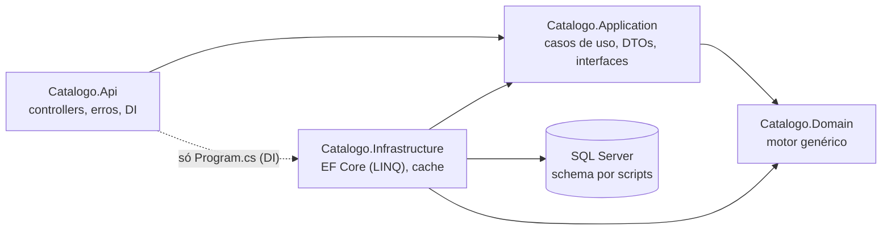

### Por que as interfaces ficam na Application?

O caso de uso precisa ler metadados e gravar registros, mas não deve saber **como** isso é feito
(EF Core, SQL Server, cache...). Ele depende só das interfaces `IMetadadosProvider`,
`IRegistroRepository` e `IUnidadeDeTrabalho` (pasta `Abstracoes/`). A Infrastructure implementa
essas interfaces, e a Api liga uma coisa à outra na injeção de dependência. Assim os casos de uso
são testados com dublês simples (`backend/tests/Catalogo.Application.Tests/Dubles`), sem banco.

### Dois modelos para os metadados

- **Domain** (`Domain/Metadados`): classes **imutáveis** (`init`), usadas pela aplicação toda e
  guardadas em cache. Como são compartilhadas entre requisições, nunca podem ser alteradas.
- **Infrastructure** (`Persistencia/Tabelas`, sufixo `Tabela`): espelham as tabelas coluna por coluna,
  só para o EF ler. O `MetadadosProvider` converte uma coisa na outra e confere as chaves reservadas (RN14).

Os **dados** (`Registro`, `RegistroReferencia`, `RegistroChaveUnica`, `RegistroValor`) são classes
simples do Domain, mapeadas direto pelo EF.

### Peças compartilhadas entre criar e atualizar

Criar e atualizar usam o **mesmo código**, sem lógica duplicada:

- `PreparadorRegistro` (Application/Comum): validação completa (RN01 a RN09) e verificação prévia de unicidade;
- `SincronizadorRegistro` (Domain/Registros): copia os dados validados para o `Registro`, mantendo
  `Dados`, `Referencias`, `Valores` e `ChavesUnicas` coerentes. Remove o que saiu, altera o que mudou e insere o que é novo;
- `MontadorRegistroDto` (Application/Comum): monta a resposta com os rótulos das referências em lote (RN20).

## Fluxo de uma criação de registro

`POST /api/v1/grupos/{grupo}/entidades/{entidade}/registros` com um JSON plano no corpo, por exemplo
`{ "comunidade": "<guid>", "codigo_sigla": "CAG" }`.

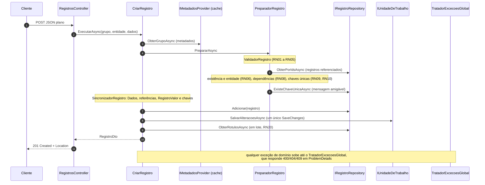

Passo a passo, como está em `Application/CasosDeUso/CriarRegistro.cs`:

1. **Metadados**: busca grupo e entidade (do cache). Se não existirem, `RecursoNaoEncontradoException` (404).
2. **Validação**: o `ValidadorRegistro` confere cada campo e devolve **todos** os erros (400).
3. **Separação**: campos simples vão para `Registro.Dados` (e `RegistroValor`), e as referências vão para `RegistroReferencia`.
4. **Referências**: cada registro apontado precisa existir e ser da entidade certa.
5. **Dependências**: o `ValidadorDependencias` confere as `CampoDependencia`. Os erros dos passos 4 e 5 voltam juntos (400).
6. **Unicidade**: calcula o hash de cada restrição e confere se já existe (409). Depois grava tudo
   num único `SaveChanges`, numa única transação.
7. **Corrida**: se outra requisição gravou o mesmo valor entre o passo 6 e o `SaveChanges`, o
   UNIQUE do banco barra (erros 2601/2627). A Infrastructure lança `ViolacaoUnicidadeBancoException`,
   e o caso de uso a converte no mesmo 409 do passo 6.

A **atualização** (`AtualizarRegistro`, RN15) segue o mesmo caminho, com dois passos antes: carrega o
registro (404) e confere a `versao` do corpo (409 se diferente, RN12). Essa versão também vai para o
`WHERE` do UPDATE.

## Fluxo da exclusão em cascata

`DELETE .../registros/{id}` (RN16). O **Domain decide** quem entra no plano; a Infrastructure só busca e executa.

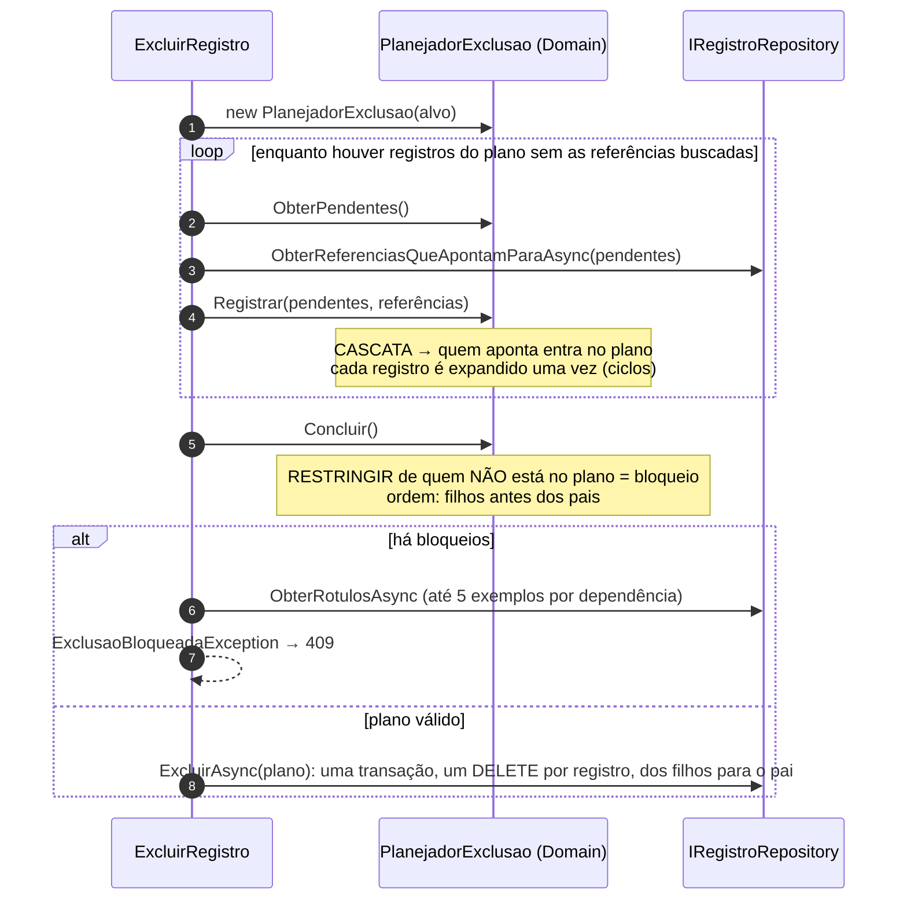

Exemplo com o seed: excluir um `relatorio_teste` que tem 2 cenários e 1 link.

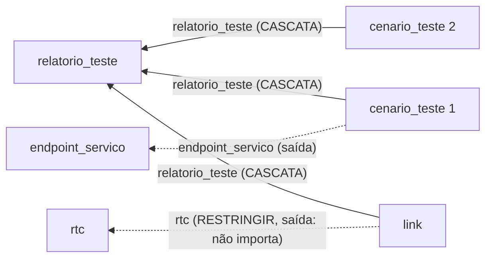

Plano: `cenario 1, cenario 2, link, relatorio` (filhos primeiro). O `rtc` e o `endpoint_servico`
não entram: eles são **apontados** pelos registros excluídos, não apontam para eles.

## Fluxo da listagem

`GET .../registros?nome_servico.contem=pix&ordenacao=-vazao_media_tps&pagina=2` (RN17 a RN19).

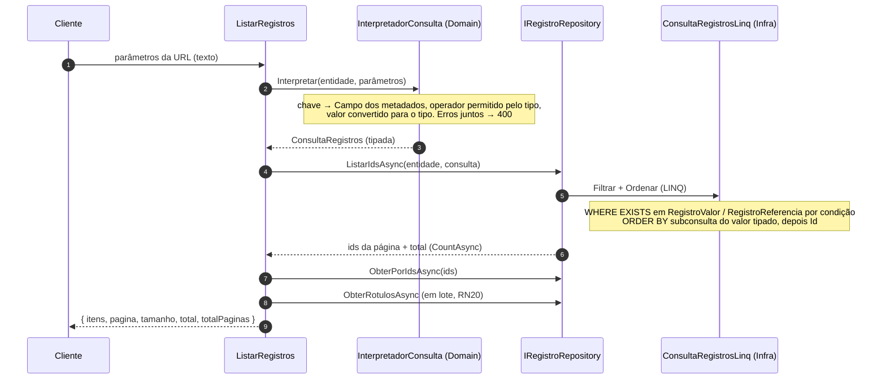

A interpretação e o escopo de segurança (equipes, RN26; aprovação, RN37) ficam no `PreparadorConsultaRegistros`, usado também pela exportação (RN49).

São 4 consultas por página, qualquer que seja o tamanho: contagem, ids, registros e rótulos. Nenhum
texto da URL vira SQL: os campos vêm dos metadados e os valores viram parâmetros do EF Core
([ADR 0011](adr/0011-consultas-somente-linq.md)). A filtragem usa a tabela de valores tipados
`RegistroValor` ([ADR 0013](adr/0013-registro-valor.md)).

As **opções de campo** (`ListarOpcoes`, RN21) reaproveitam a mesma consulta: um filtro "igual" no
`CampoAlvo` da dependência, um `contem` no campo de exibição e a ordenação pelo rótulo.

## Autenticação, permissões e histórico

Detalhes do login e do token em [seguranca.md](seguranca.md). Em resumo, para toda requisição:

1. **JwtBearer** valida o token (401 se ausente ou inválido). O fallback de autorização exige login em
   todo endpoint, salvo `[AllowAnonymous]` (só o login e o `/health`).
2. **`VerificacaoUsuarioMiddleware`** lê a situação atual do usuário (`ISituacaoUsuarios`, cache de 1 min):
   desativado → 401; senha provisória pendente → 403 `TROCA_DE_SENHA_OBRIGATORIA`.
3. O **caso de uso** obtém o `UsuarioAtual` (`IUsuarioAtual`). Sob uma listagem, entra nela pelo `ObterGrupoOuFalharAsync` /
   `ObterEntidadeOuFalharAsync`: 404 se o usuário não a vê (RN90) e, daí em diante, o **usuário na listagem**
   (`PoliticaPermissao.NaListagem`), cujas equipes são só as habilitadas nela (RN91, [ADR 0046](adr/0046-listagens-habilitadas-por-equipe.md)).
   Depois pergunta à **`PoliticaPermissao`** (Domain):
   `Decidir(usuario, operacao, alvo)` → `Permitido`, `NaoEncontrado` (404) ou `Proibido` (403). O `RegistroAlvo`
   traz se é global, a equipe, a situação de aprovação, o autor e se a aprovação está ativa (montado pelo `ContextoAprovacao`).
   Nenhum controller tem `if (perfil == ...)`.
4. Listagens e opções levam o escopo de equipes e de situação **para dentro da consulta LINQ**
   (`ConsultaRegistros.EquipesPermitidas` e `NaoAprovadosSomenteDoAutor`), nunca filtram em memória.
5. Toda alteração chama o **`ServicoHistorico`**, e a linha entra no mesmo `SaveChanges`
   ([ADR 0018](adr/0018-historico-explicito-no-caso-de-uso.md)).

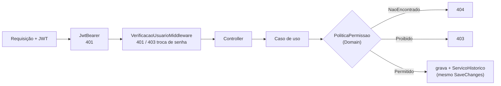

## Aprovação de registros

A aprovação é ligada por entidade e equipe ([RN33](regras-de-negocio.md#rn33--aprovação-ativável-por-entidade-e-equipe),
[ADR 0020](adr/0020-aprovacao-por-entidade-e-equipe.md)). As transições ficam em `Domain/Aprovacao/FluxoAprovacao`
(código puro); **quem** pode cada transição fica na `PoliticaPermissao`, como as demais permissões.

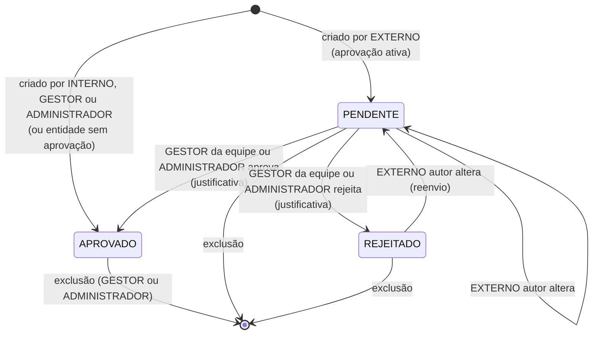

Toda transição grava histórico no mesmo `SaveChanges`. Decidir um registro que não está PENDENTE é 409.

## Avaliação de itens

O formulário de avaliação é um **modelo por entidade e equipe** ([RN40](regras-de-negocio.md#rn40--quem-configura-os-modelos-de-avaliação),
[ADR 0021](adr/0021-avaliacao-configuravel-com-tabelas-tipadas.md)). As peças seguem a mesma divisão do resto:

| Camada | Peças |
|---|---|
| Domain (`Avaliacoes/`) | `RegrasModeloAvaliacao` (validar o modelo e evoluí-lo sem perder avaliações), `RegrasAvaliacao` (validar e aplicar as respostas, só itens aprovados). **Quem** pode: `PoliticaPermissao.PodeAvaliar` e `PodeConfigurarEquipe` |
| Application (`CasosDeUso/Avaliacoes/`) | um caso de uso por operação (`CriarModeloAvaliacao`, `AvaliarRegistro`, `ListarAvaliacoesRegistro`...). O `MontadorRegistroDto` acrescenta `avaliacao` aos registros, em lote |
| Infrastructure | `ModeloAvaliacaoRepository` e `AvaliacaoRepository`: médias e contagens com `GroupBy`/`Average`/`Count` no banco. `ConsultaRegistrosLinq`: ordenação e filtro pela média como subconsulta correlacionada |

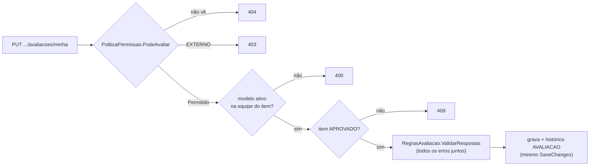

## Tratamento de erros

Os controllers não têm `try/catch`. As exceções sobem até o `TratadorExcecoesGlobal`
(`Api/Erros`), que é um `IExceptionHandler` e responde em ProblemDetails. A tabela
exceção → status está em [`backend/src/Catalogo.Api/AGENTS.md`](../backend/src/Catalogo.Api/AGENTS.md).

Todo erro traz `codigo` (estável, de `CodigosErro` no Domain), `traceId` (o mesmo do log) e, em alguns, `detalhes`
([ADR 0023](adr/0023-codigos-de-erro-estaveis-no-problemdetails.md)). Cada exceção de domínio carrega o seu código; os erros
do próprio ASP.NET (rota inexistente, 405, 415, JSON malformado, 401 sem token) recebem um código padrão por status em
`ExtensoesProblema.Completar`. A tabela para o front está em [`api/codigos-de-erro.md`](api/codigos-de-erro.md).

## Administração de metadados

Listagens são criadas e alteradas pela API (`/api/v1/admin/metadados`, só o ADMINISTRADOR, RN50 a RN77,
[ADR 0025](adr/0025-administracao-de-metadados-so-pelo-administrador.md)). Toda escrita passa pelo mesmo caminho
(`ExecutorAlteracaoMetadados`, Application):

| Camada | Peça |
|---|---|
| Domain (`Metadados/Administracao`) | `RegrasMetadados`: regras de configuração, sem dados (chaves, tipos, referências, exibição, restrições, dependências e ciclos). `PlanejadorAlteracoes`: para cada mudança, as **verificações contra os dados** e as **escritas em massa** que ela exige |
| Application (`CasosDeUso/Metadados`) | um caso de uso por operação; o `ExecutorAlteracaoMetadados` faz o resto: transação, verificações, simulação, bloqueio, gravação, histórico e cache |
| Infrastructure | `MetadadosAdminRepository` (escrita e versão), `VerificadorDadosMetadados` (as verificações em LINQ), `EscritorRegistrosMetadados` (valor padrão e chaves únicas em lotes de 500) |

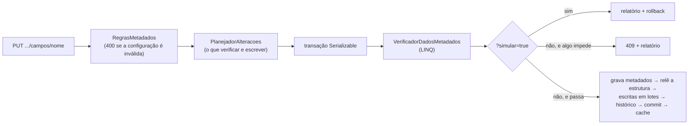

Mudanças incompatíveis com os dados são **bloqueadas**, não migradas ([ADR 0026](adr/0026-bloquear-alteracoes-incompativeis-com-os-dados.md));
chaves são imutáveis ([ADR 0027](adr/0027-chaves-de-metadados-imutaveis.md)); o normal é desativar
([ADR 0028](adr/0028-desativar-em-vez-de-excluir-metadados.md)); e toda escrita é simulável
([ADR 0029](adr/0029-simulacao-de-alteracoes-de-metadados.md)).

## Contrato com o front-end

- Rotas sob `/api/v1` ([ADR 0022](adr/0022-versionamento-por-prefixo-de-rota.md)); na v1 o contrato só cresce.
- O OpenAPI gerado fica em `backend/openapi/v1.json` e um teste falha se ele mudar sem querer
  ([ADR 0024](adr/0024-contrato-openapi-versionado-e-verificado.md)).
- CORS por configuração, sem cookies ([seguranca.md](seguranca.md#cors)).
- Guia de uso: [`api/README.md`](api/README.md).

### Exportação da listagem

`ExportarRegistros` (Application) usa o mesmo `PreparadorConsultaRegistros` da listagem: os mesmos filtros e o mesmo
escopo do usuário. Lê em lotes de 500 da mesma consulta, monta cada lote com o `MontadorRegistroDto` (rótulos, autores e
médias em lote) e entrega as linhas a um `IGeradorArquivoExportacao` da Infrastructure (`GeradorCsv`, `GeradorXlsx` com
ClosedXML), que escreve direto na resposta (RN49).

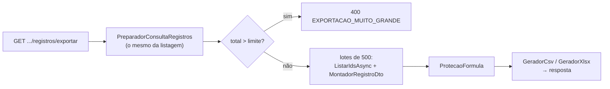

## Painel gerencial

Visão geral por grupo e agregação configurável por entidade (RN78 a RN88, [`api/painel.md`](api/painel.md)). Três decisões guiam o
desenho: os indicadores são **genéricos**, montados pelos metadados ([ADR 0030](adr/0030-indicadores-genericos-pelos-metadados.md));
a **conta é do banco**, em LINQ ([ADR 0031](adr/0031-agregacao-no-banco-em-linq.md)); e só GESTOR e ADMINISTRADOR acessam, com a
**visibilidade da listagem** ([ADR 0032](adr/0032-painel-so-para-gestor-e-administrador.md)).

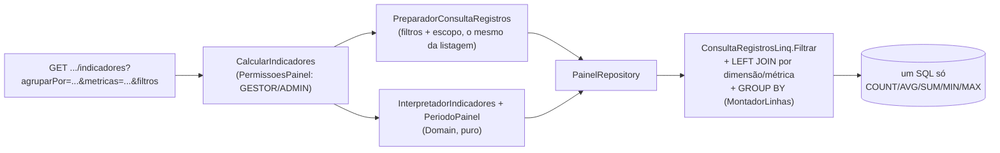

- **Domain** (`Painel/`): `InterpretadorIndicadores` valida `agruparPor`, `metricas`, `ordenarPor` e `limite` contra os metadados e
  devolve uma `ConsultaIndicadores` tipada; `PeriodoPainel` converte `de`/`ate` (fuso de negócio) em limites UTC.
- **Application** (`CasosDeUso/Painel/`): `ObterVisaoGeral`, `CalcularIndicadores` e `ExportarIndicadores`. Juntam os erros de todas as
  partes num 400, somam os números das entidades e formatam as linhas (rótulos em lote).
- **Infrastructure** (`Painel/`): `PainelRepository` e `ConsultaIndicadoresLinq`/`MontadorLinhas`. Toda consulta parte de
  `ConsultaRegistrosLinq.Filtrar`; os valores dos campos entram por LEFT JOIN (o SQL Server não aceita subconsulta em `GROUP BY`).
- A exportação dos indicadores reaproveita os `IGeradorArquivoExportacao` e a `ProtecaoFormula` da exportação da listagem.
