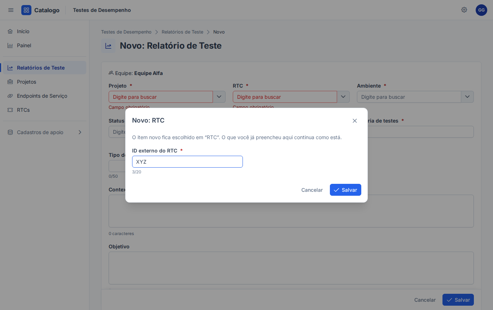
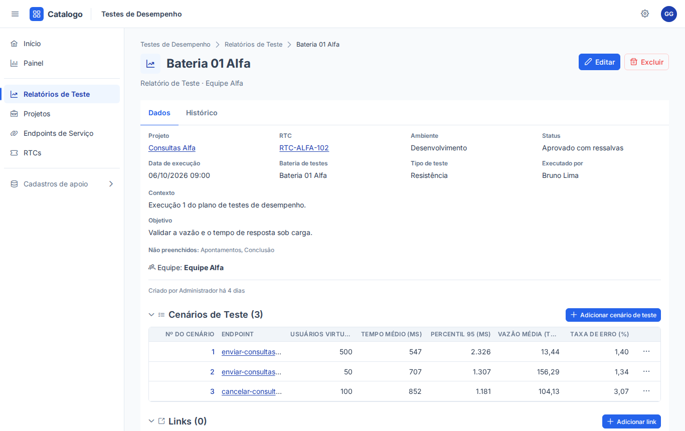
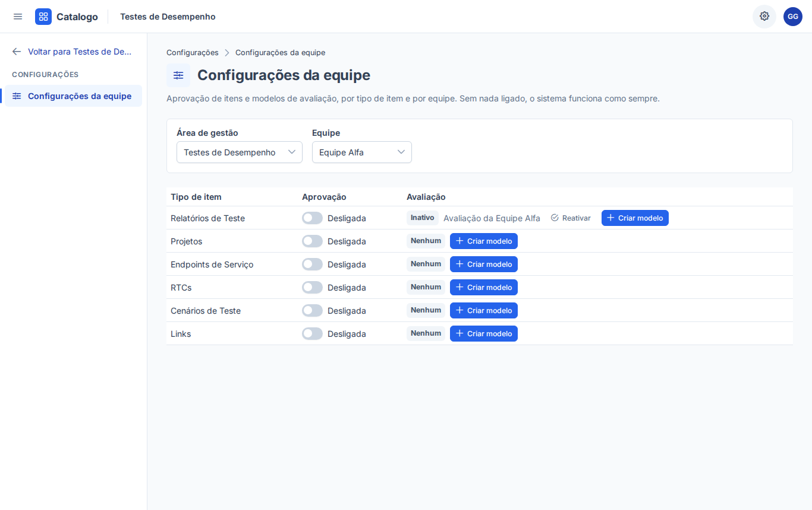
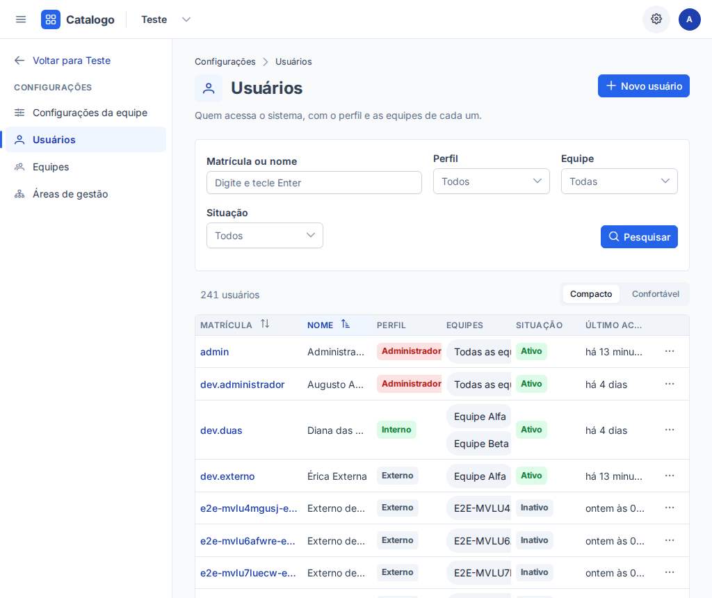
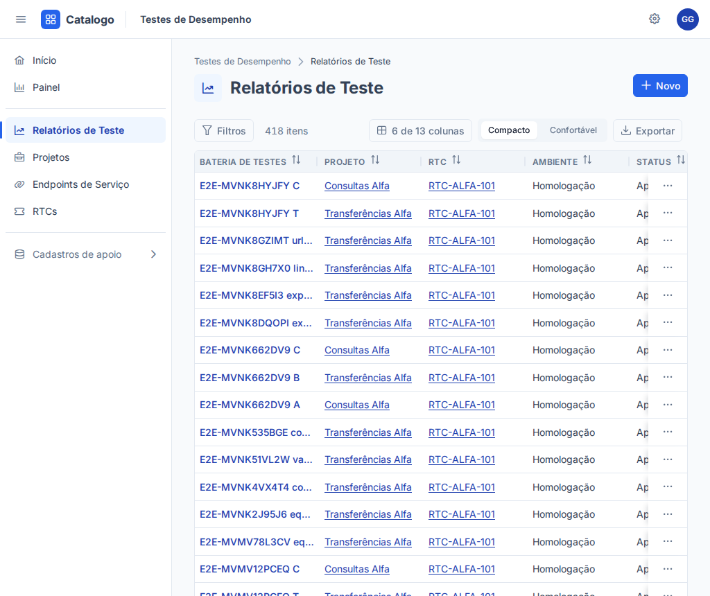

# Revisão de usabilidade (etapa 9)

Avaliação heurística de **todas as telas** depois da nova navegação, das tabelas largas, da página Início e do "Criar novo". Base:

- as **10 heurísticas de Nielsen** (H1 a H10, abaixo);
- a **WCAG 2.2 nível AA**: contraste (1.4.3 e 1.4.11), foco visível (2.4.7 e 2.4.11), tamanho de alvo (2.5.8), nomes acessíveis
  (4.1.2) e ordem de foco (2.4.3);
- a consistência com o PrimeNG e com os fundamentos visuais (`src/app/tema/fundamentos.scss`).

**Como foi feita.** Capturas de cada tela nos temas claro e escuro, nas larguras 1366, 1920 e 1024 px (e 900 px, para a gaveta do
menu), com os usuários de desenvolvimento (externo, interno, gestor e administrador). O contraste foi **medido** no navegador (cores
calculadas pelo CSS, fórmula da WCAG), não estimado. Data: 25/10/2026.

**Telas revisadas:** login e troca de senha; Início; listagens (com filtros e seletor de colunas); detalhe com relacionados e
filhos; formulários (novo, editar e o diálogo "Criar novo"); painel e análise personalizada; fila de aprovações e aba de
avaliações; configurações da equipe, usuários (lista, novo, detalhe), equipes, áreas de gestão e editor do tipo de item; Minha
conta; menu do usuário; "sem permissão", "não encontrado" e "nenhuma área de gestão".

| Heurística | |
|---|---|
| H1 | Visibilidade do estado do sistema |
| H2 | Correspondência com o mundo real |
| H3 | Controle e liberdade |
| H4 | Consistência e padrões |
| H5 | Prevenção de erros |
| H6 | Reconhecer em vez de lembrar |
| H7 | Flexibilidade e eficiência |
| H8 | Estética e design minimalista |
| H9 | Ajudar a reconhecer, diagnosticar e corrigir erros |
| H10 | Ajuda e documentação |

## Resumo

| Severidade | Achados | Corrigidos | Pendentes |
|---|---|---|---|
| Alta | 3 | 3 | 0 |
| Média | 10 | 10 | 0 |
| Baixa | 8 | 0 | 8 |
| **Total** | **21** | **13** | **8** |

## Severidade alta

### A1 — Títulos das colunas das tabelas abaixo do contraste mínimo (tema claro)

- **Telas:** todas as tabelas largas (listagens, relacionados, filhos, fila, usuários, equipes, áreas de gestão).
- **Problema:** texto de 12 px, cinza secundário sobre o fundo cinza claro do cabeçalho: **4,34:1** (medido).
- **Critério:** WCAG 1.4.3 (texto pequeno precisa de 4,5:1); H8.
- **Recomendação:** um token próprio, mais escuro, para o texto do cabeçalho das tabelas.
- **Situação:** **corrigido.** Token `--cor-texto-cabecalho-tabela` em `fundamentos.scss` (claro: `surface-600`): **6,92:1** no claro e
  5,81:1 no escuro.

### A2 — Borda dos campos de formulário quase invisível

- **Telas:** todos os formulários e filtros (inputs, selects, datas).
- **Problema:** a borda padrão do Aura fica em **1,48:1** no claro e **2,29:1** no escuro: o limite do campo some, sobretudo em
  monitores com pouco contraste.
- **Critério:** WCAG 1.4.11 (componentes de interface precisam de 3:1); H6.
- **Recomendação:** bordas de `surface-500` nos dois temas; borda de erro também com 3:1.
- **Situação:** **corrigido** em `tema.ts` (`colorScheme.light/dark.formField`): **4,76:1** no claro e **3,67:1** no escuro. A borda de
  erro passou a `red-600` (claro) e `red-400` (escuro).

### A3 — Erros de validação aparecem antes de a pessoa digitar

- **Telas:** formulário de item (página e diálogos) e, ao ganhar foco automático, login, troca de senha, usuário e equipe.
- **Problema:** com o foco automático no primeiro campo, basta clicar em outro campo para o primeiro ficar vermelho com "Campo
  obrigatório". Ao abrir o diálogo "Criar novo" pelo select, o formulário de trás já aparecia cheio de erros.
- **Critério:** H5, H9; WCAG 3.3.1 (a mensagem certa, na hora certa).
- **Recomendação:** mostrar o erro só depois que a pessoa **altera** o campo ou **tenta salvar**.
- **Situação:** **corrigido.**
  - `CampoFormularioComponent.mostrarErros` usa "alterado ou com erro do servidor", e o "Salvar" marca todos como alterados.
  - Login, troca de senha, usuário e equipe seguem a mesma regra ("alterou ou tentou salvar").

## Severidade média

### M1 — Mais de uma ação primária na mesma tela

- **Telas:**
  - detalhe: Editar + "Adicionar cenário" + "Adicionar link" + "Novo Relatório de Teste" nas seções;
  - configurações da equipe: seis "Criar modelo";
  - listagem, usuários e equipes: "Filtrar"/"Pesquisar" ao lado do "Novo".
- **Critério:** H8, H4. O olho não acha a ação principal.
- **Situação:** **corrigido.**
  - As ações das seções e "Criar modelo" passaram a secundárias (contorno cinza).
  - "Filtrar" e "Pesquisar" ficaram com contorno.
  - A única ação cheia é a do cabeçalho da página.
  - "Novo <tipo>" das seções virou "Adicionar <tipo>", como nos itens filhos, e evita o "novo"/"nova".

### M2 — Texto cortado com reticências sem como ver o inteiro

- **Telas:** listagens, relacionados e filhos (coluna principal, títulos das colunas, valores longos).
- **Critério:** H6. O nome da bateria ou do campo fica pela metade.
- **Situação:** **corrigido.** A dica do navegador (`title`) traz o texto inteiro:
  - no link da coluna principal;
  - nos títulos das colunas;
  - nos valores das células (`ValorCampoComponent`; a URL já tinha a sua dica).

### M3 — Tabela de usuários espremida a 1024 px

- **Problema:** sem largura por coluna, a tabela dividia o espaço igualmente. As etiquetas de perfil e os chips de equipe eram
  cortados no meio da palavra, e as linhas com duas equipes ficavam altas.
- **Critério:** H8; WCAG 1.4.10 (conteúdo cortado em vez de rolar).
- **Situação:** **corrigido.** Cada coluna tem a sua largura (abaixo disso a tabela rola, com a sombra). As equipes viraram texto
  numa linha, com reticências e o texto inteiro na dica.

### M4 — Análise personalizada fora do padrão das outras telas

- **Problema:** título sem ícone, trilha sem a área de gestão, e "Escolha o tipo de item para começar" solto, sem o estado vazio
  padrão. O erro também não tinha "Tentar de novo".
- **Critério:** H4.
- **Situação:** **corrigido.**
  - Cabeçalho padrão (`app-cabecalho-pagina`), com a trilha Área › Painel › Análise.
  - Estado vazio (`app-estado-vazio`) e estado de erro (`app-estado-erro`) padronizados.

### M5 — Editor do tipo de item não atualiza a área atual

- **Problema:** abrindo um tipo de item de "Testes de Desempenho", o seletor do cabeçalho continuava mostrando outra área, e o
  "Voltar para …" levava a ela.
- **Critério:** H1 (o cabeçalho mostrava um estado errado).
- **Situação:** **corrigido.** O editor chama `AreaAtualService.definir`, como o detalhe da área já fazia.

### M6 — Formulário longo sem grupos

- **Problema:** relatório de teste com 12 campos numa lista corrida.
- **Critério:** H8, H6.
- **Situação:** **corrigido.** Com mais de 6 campos, o formulário genérico separa "Dados principais" (os curtos) e "Descrições" (os
  textos longos), com título (`h2`). A barra de ações fixa no rodapé já existia.

### M7 — "Salvar" sem dizer o quê

- **Telas:** formulário de item (página e diálogos).
- **Critério:** H2, H4. Botões com verbo **e** objeto, pelo guia de interface.
- **Situação:** **corrigido.**
  - Criar: "Salvar relatório de teste", "Salvar RTC" (o nome do tipo no meio da frase, com as siglas mantidas: `nomeEmFrase`).
  - Editar: continua "Salvar alterações" ou "Reenviar para aprovação".

### M8 — Indicação de rolagem horizontal fraca

- **Problema:** a sombra das colunas presas era sutil demais no tema claro: a 1024 px a coluna da direita aparecia cortada sem
  sinal claro de que havia mais.
- **Critério:** H1.
- **Situação:** **corrigido.** A sombra ficou mais larga e mais escura (`--cor-sombra-rolagem`). Ela usa atributos `data-rolagem-*`
  (o `p-table` reescreve o próprio `class`).

### M9 — Toasts somem em 3 segundos

- **Problema:** o padrão do PrimeNG é 3 s. Mensagens mais longas ("Item criado e enviado para aprovação. Ele já está escolhido em
  …") não davam tempo de ler.
- **Critério:** WCAG 2.2.1 (tempo suficiente); H1.
- **Situação:** **corrigido.** 5 s para todos (`app.ts`). Os de erro continuam com 6 s, e 15 s nos 500 (`erro.interceptor.ts`).

### M10 — Sem foco no primeiro campo fora do formulário genérico

- **Telas:** login, troca de senha, novo/editar usuário, nova/editar equipe.
- **Critério:** H7 e o guia de interface (foco automático no primeiro campo).
- **Situação:** **corrigido.**
  - Diretiva `appFocoInicial` (`shared/acessibilidade/foco-inicial.directive.ts`).
  - Na edição do usuário, o foco vai para o nome (a matrícula não muda).

## Severidade baixa (pendentes)

| # | Tela | Problema | Critério | Recomendação |
|---|---|---|---|---|
| B1 | Troca de senha | O link "Sair" fica solto, abaixo dos botões, alinhado à esquerda | H4, H8 | Mover para o rodapé do cartão, separado das ações do formulário |
| B2 | Detalhe do item | A equipe aparece duas vezes: no subtítulo e na linha "Equipe: …" | H8 | Manter só no subtítulo |
| B3 | Menu de configurações | "Voltar para Testes de De…" fica cortado sem dica | H6 | Dica com o nome inteiro, ou só "← Voltar" com o nome na dica |
| B4 | Usuários | A etiqueta do perfil "Interno" usa o mesmo verde do "Ativo" (cores com sentidos diferentes) | H4 | Perfis em tons neutros; verde e vermelho só para situação |
| B5 | Tabelas | Títulos de coluna em caixa alta: mais difíceis de ler quando longos | H8 | Caixa normal com peso 600 |
| B6 | Filtros da listagem | Todos os campos viram filtro, inclusive textos longos (13 no relatório) | H8 | Mostrar primeiro os campos das colunas visíveis e "Mais filtros" |
| B7 | Cabeçalho abaixo de 1024 px | O nome "Catalogo" some, fica só o símbolo | H6 | Mantê-lo enquanto couber (acima de 600 px) |
| B8 | Formulários da administração de áreas | Os diálogos (área, tipo de item) ganham foco do PrimeNG no primeiro campo e mostram "Campo obrigatório" ao sair dele sem digitar (`errosDe` usa "tocado") | H5 | Mesma regra do formulário de itens: erro só depois de alterar ou tentar salvar |

## Padrões conferidos em todas as telas

| Padrão | Resultado |
|---|---|
| Uma ação primária por tela | ok depois da M1 |
| Botões com verbo | ok depois da M7 ("Novo" do cabeçalho mantido: convenção de mercado, e o nome acessível diz o tipo: "Novo: Relatório de Teste") |
| Confirmações destrutivas dizem o que se perde | ok: excluir item ("não pode ser desfeita", cita os filhos), desativar usuário ("perde o acesso em até 1 minuto"), desativar equipe (membros afetados) |
| Estados carregando / vazio / erro | ok: skeleton em todas as telas com dados; `app-estado-vazio` e `app-estado-erro` nas listagens, Início, fila, painel, análise, configurações e administração |
| Formulários | rótulos visíveis; grupos nos longos (M6); foco no primeiro campo (M10); Enter salva nos diálogos (são `<form>` com botão submit); barra de ações fixa nos longos |
| Responsividade | nada quebra em 1024 px (tabelas rolam com indicação, M3 e M8); abaixo de 1024 px o menu vira gaveta, que fecha com Esc e ao navegar |
| Toasts | num só canto (alto, à direita), curtos, 5 s (M9) |
| Contraste (medido) | texto 10,4:1 / 17,7:1; texto secundário ≥ 4,55:1; links ≥ 8,7:1; botão primário ≥ 5,2:1; etiquetas ≥ 4,57:1; foco ≥ 6,4:1 (claro / escuro) |
| Foco visível | contorno de 2 px na cor de foco em todos os controles; dentro das células, o contorno fica por dentro (não é cortado) |
| Tamanho de alvo | botões do cabeçalho 40 px; "⋯" e setas da administração ≥ 24 px (WCAG 2.5.8) |
| Nomes acessíveis | conferidos nos E2E por `getByRole` com nome (menus, "Ações de <item>", seletor de colunas, alça de redimensionar, seletor de ícone) |

## Investigação: o filtro de Equipe que "não fechava no primeiro Esc"

Na etapa 8, um teste precisou repetir o Esc para fechar a lista do filtro de Equipe. Ele foi reproduzido com o Playwright:

- **telas:** filtro da listagem, painel e fila;
- **tentativas:** 20 por tela, com e sem animação, apertando o Esc logo que a primeira opção aparece;
- **resultado:** 0 falhas em 120 tentativas.

**Não é defeito da interface.** A causa mais provável era o código antigo servido pelo `ng serve` no WSL, ou o seletor de listagem
que ficava no menu antigo. O contorno foi removido do teste (`e2e/listagens-por-equipe.spec.ts → opcoesDe`), e a suíte continua
verde.
