# Guia: aprovação e avaliação de itens

Este guia é para **gestores** e **administradores** que querem que os itens de uma equipe passem por uma **aprovação** antes de valer,
ou que sejam **avaliados** com notas. Os dois recursos são ligados **por equipe e por tipo de item** (por exemplo: só os Relatórios de
Teste da Equipe Alfa). Onde nada estiver ligado, o sistema funciona exatamente como sempre.

> As imagens vêm de uma equipe de teste ("Equipe E2E-…"); a sua terá o nome dela.

## Quem faz o quê

| Perfil | Aprovação | Avaliação |
|---|---|---|
| **Externo** | cadastra itens, que ficam **pendentes**; corrige e reenvia os rejeitados | vê só o resumo (as médias) |
| **Interno** | cadastra como sempre: os itens dele já nascem aprovados | avalia; vê o resumo e as avaliações de cada pessoa |
| **Gestor** | liga e desliga na equipe dele; aprova e rejeita | cria o modelo de avaliação; avalia |
| **Administrador** | o mesmo, em todas as equipes habilitadas na listagem | o mesmo, em todas as equipes habilitadas na listagem |

## 1. Ligar a aprovação

No menu, abra **Configurações da equipe** (só gestores e administradores veem). Escolha a listagem e a equipe: aparece uma linha por
tipo de item. Só aparecem as listagens e as equipes que se cruzam: as suas equipes **habilitadas naquela listagem** (o administrador
habilita as equipes na aba Equipes de cada listagem).

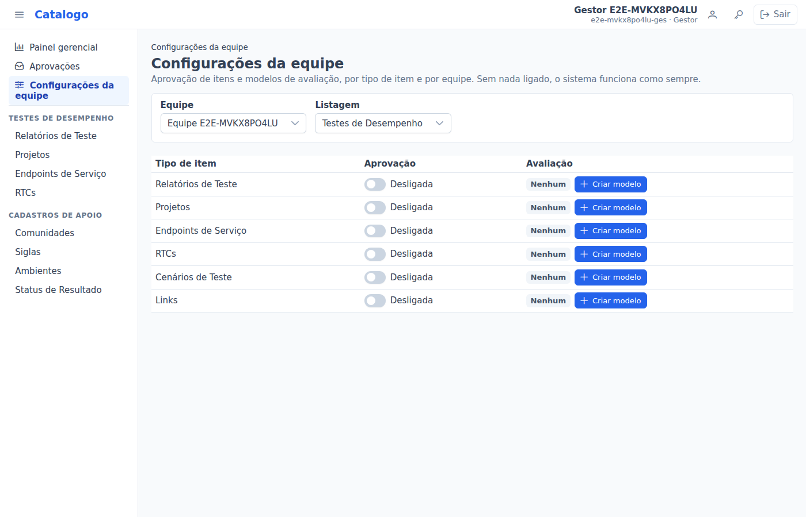

Clique no alternador de **Aprovação**. Antes de ligar, o sistema explica o que muda para cada perfil. Confira e clique em
**Ligar a aprovação**. Os itens que já existem continuam aprovados.

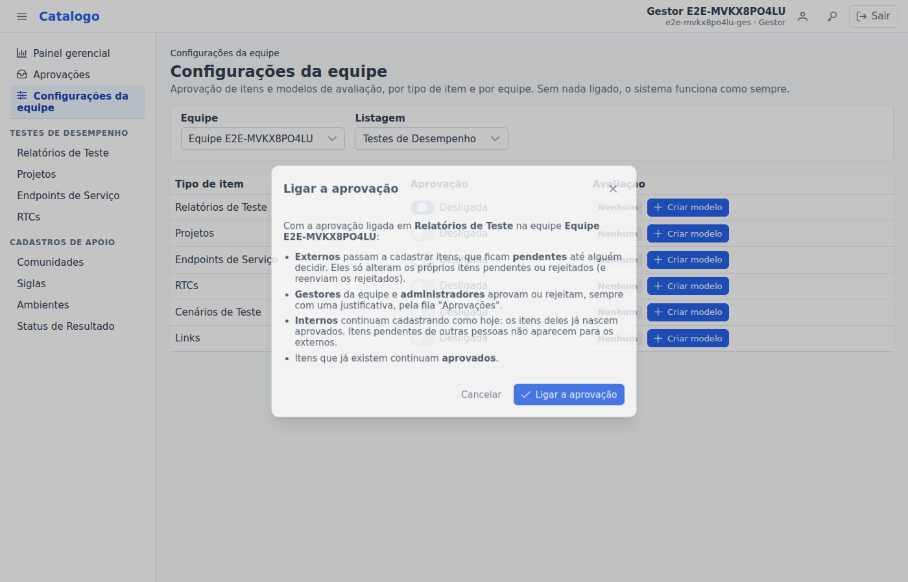

## 2. O dia a dia da aprovação

**O externo cadastra.** O formulário avisa "Este item será enviado para aprovação". Depois de salvar, o item fica **Pendente**: só o
autor e quem decide o veem.

**Quem decide vê o contador.** O menu **Aprovações** mostra quantos itens esperam (o número é atualizado a cada troca de tela e a cada
2 minutos). A fila mostra os mais antigos primeiro, com o autor e há quanto tempo o item espera.

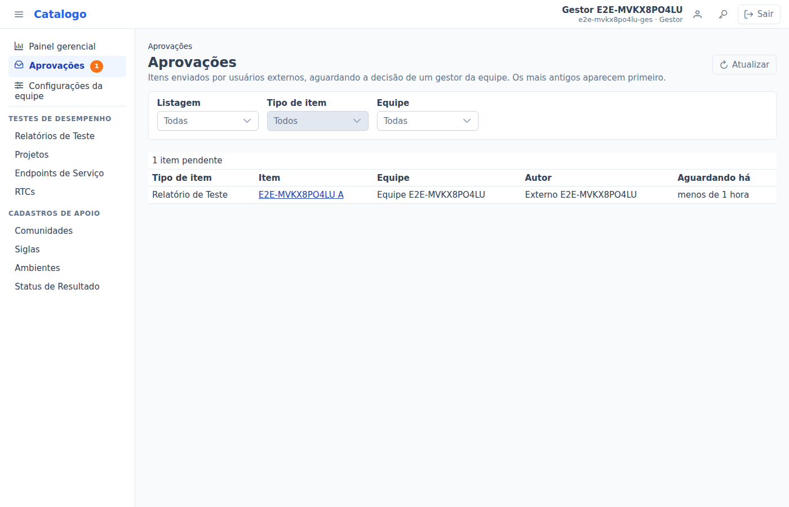

**Aprovar ou rejeitar.** Abra o item: no topo há uma faixa com a situação e os botões **Aprovar** e **Rejeitar**. Os dois pedem uma
**justificativa** (de 10 a 1000 caracteres). Ela fica guardada e aparece para o autor. Depois de decidir, você volta para a fila.

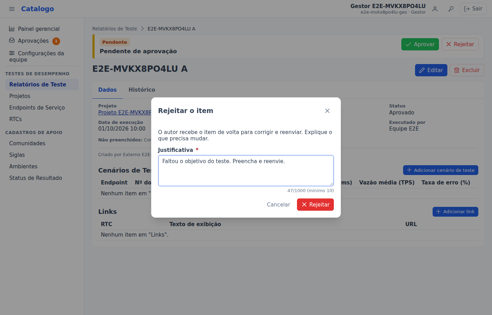

**O autor corrige e reenvia.** Um item rejeitado mostra ao autor a faixa "Rejeitado — corrija e reenvie", com a justificativa. Ao
editar, o botão de salvar vira **Reenviar para aprovação** e o item volta para a fila. Depois de aprovado, o externo não altera mais
o item.

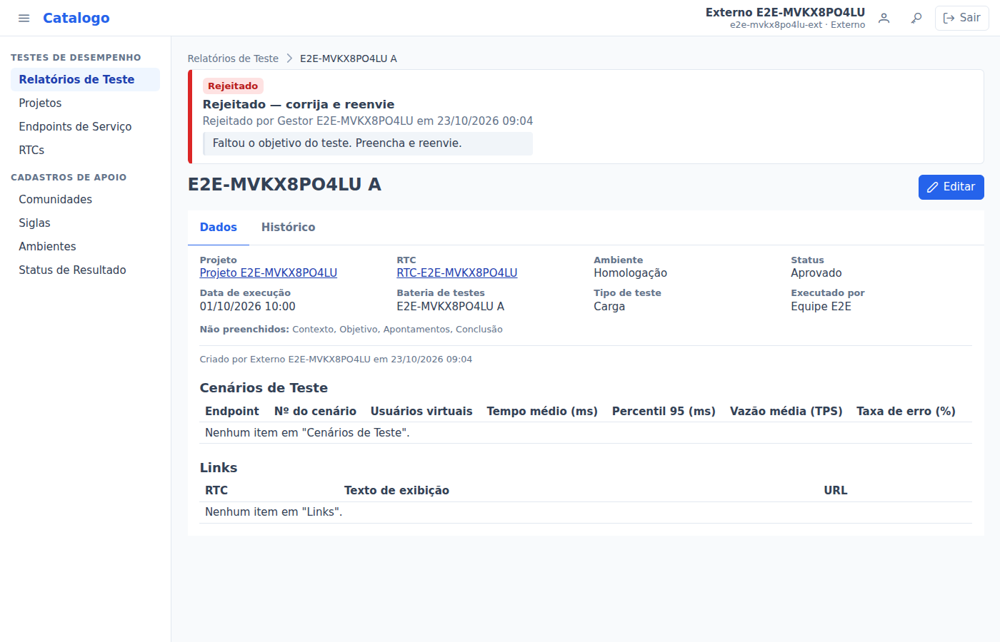

Na lista, a coluna **Situação** mostra Pendente (amarelo), Aprovado (verde) e Rejeitado (vermelho), e os **Filtros** permitem ver só uma
situação. A aba **Histórico** de cada item guarda todas as decisões, com as justificativas em destaque.

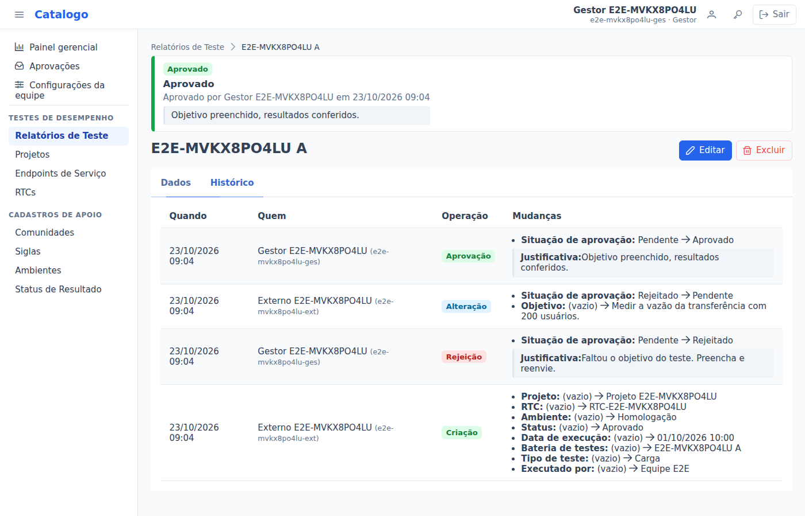

## 3. Desligar a aprovação

Só é possível desligar quando **não há itens pendentes**. Se houver, o sistema diz quantos e oferece o link para a fila já filtrada:
decida os pendentes e desligue de novo.

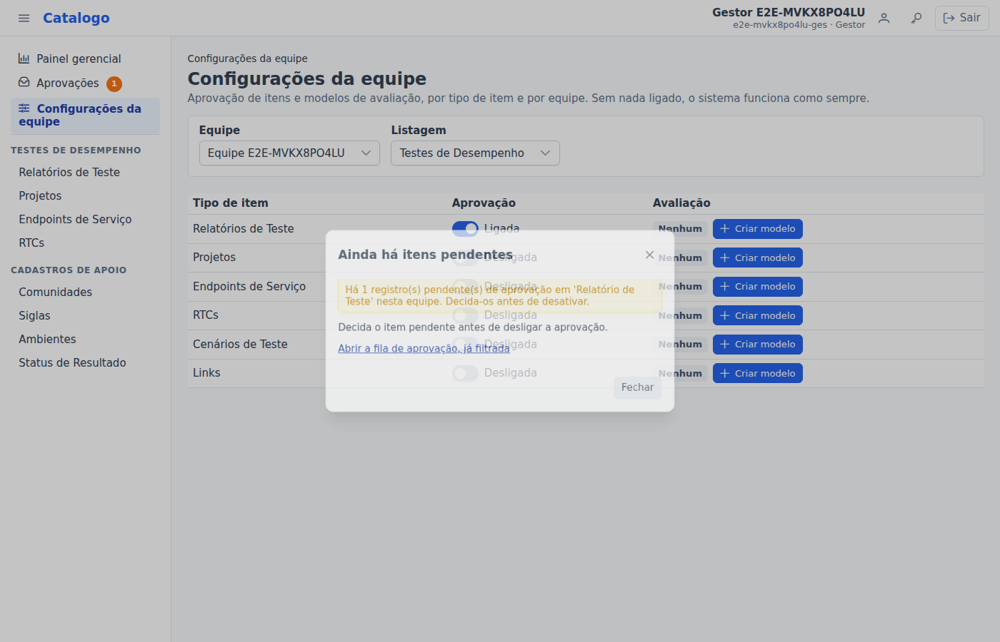

## 4. Criar um modelo de avaliação

Em **Configurações da equipe**, clique em **Criar modelo** na linha do tipo de item. Dê um nome ao modelo e monte os **critérios**:

- **Estrelas (1 a 5)**: uma nota. Escolha se o comentário é proibido, opcional ou **obrigatório**;
- **Texto livre**: um campo de texto (por exemplo, "Observações");
- **Obrigatório**: a avaliação não é aceita sem esse critério;
- A **chave** é gerada do nome e não muda depois de gravada.

A ordem dos critérios é a ordem do formulário: arraste pela alça (☰) ou use as setas. À direita, a **pré-visualização** mostra o
formulário como as pessoas vão ver; dá para testar, nada é gravado.

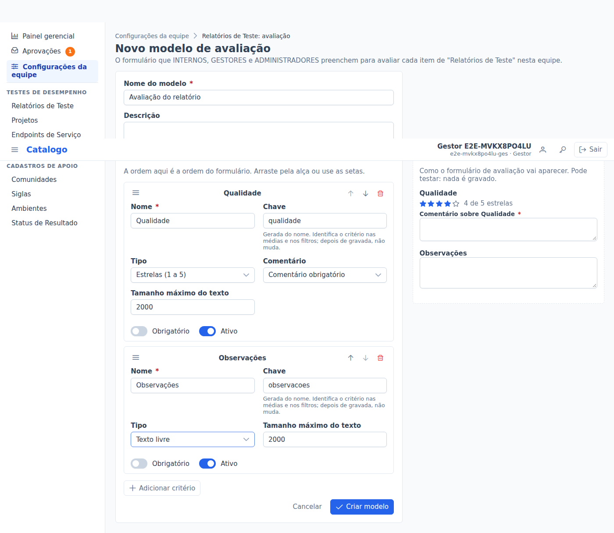

Uma equipe tem **um modelo ativo** por tipo de item. Em **Desativar** a avaliação some das telas (as notas ficam guardadas); em
**Reativar** ela volta.

### Mudar um modelo que já tem respostas

Um critério que **já recebeu notas** não pode ser excluído nem mudar de tipo, porque as notas dadas perderiam o sentido. Para tirá-lo do
formulário e das médias, **desative** o critério; as respostas antigas ficam guardadas.

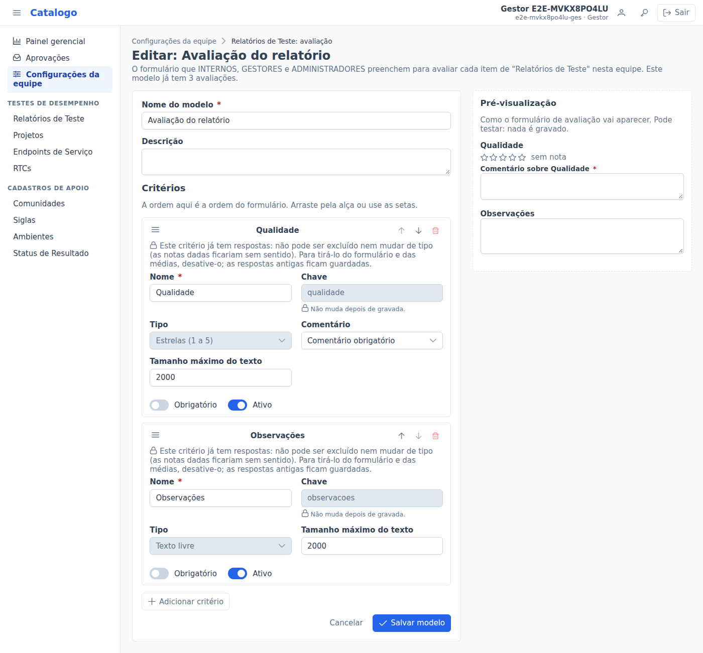

## 5. Avaliar e acompanhar

No detalhe do item, a aba **Avaliações** mostra:

- o **Resumo**: para cada critério de estrelas, a média (em estrelas e em número), quantas notas e como elas se distribuem de 1 a 5;
- **Minha avaliação** (internos, gestores e administradores): dê as notas, escreva os comentários e salve. Dá para editar ou remover
  depois. Itens ainda não aprovados não podem ser avaliados;
- as **Avaliações individuais**, de cada pessoa (não aparecem para externos).

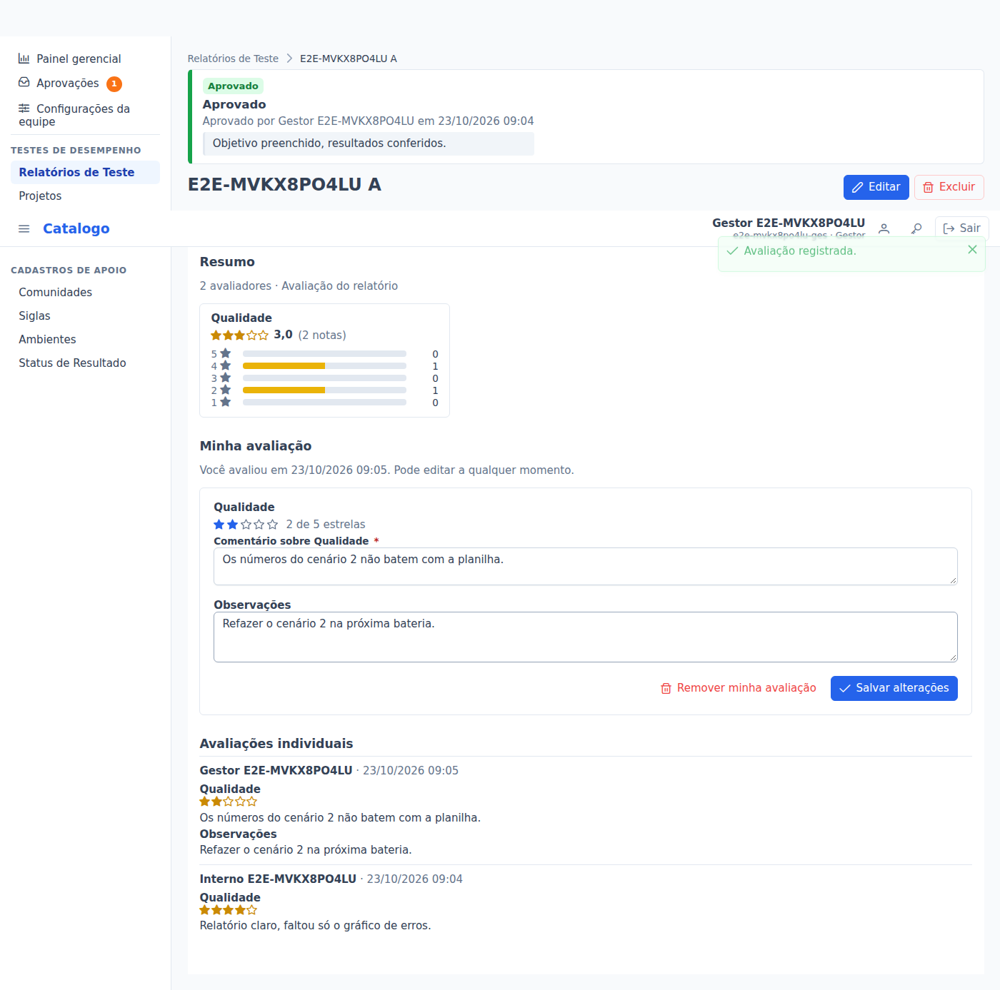

O externo vê só o resumo:

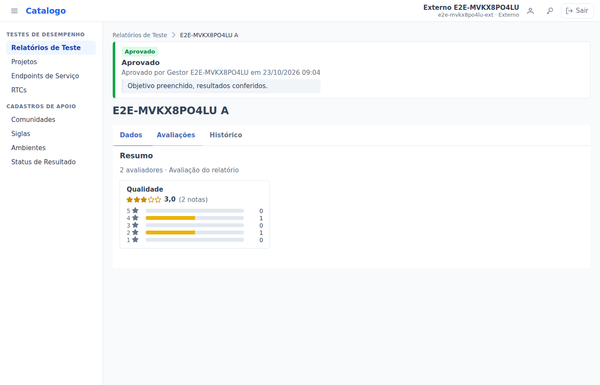

Na lista, o seletor de **colunas** oferece uma coluna "Média: …" por critério de estrelas. Clique no título para ordenar (os itens sem
nota ficam sempre por último). A exportação (CSV e XLSX) também traz as médias.

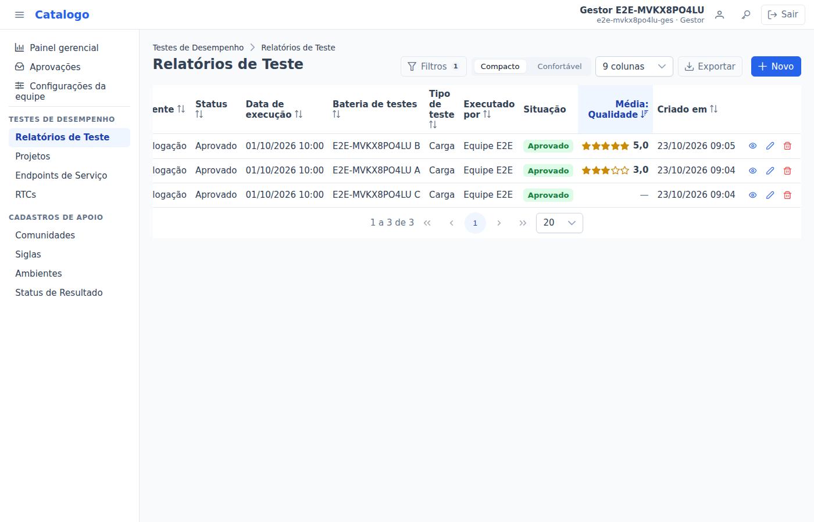

O **Painel gerencial** mostra os blocos **Aprovação** (pendentes, aprovados, rejeitados, tempo até a decisão) e **Avaliação** (médias,
distribuição e ranking) das equipes que você vê.
