# Guia do administrador: criar uma listagem

Este guia mostra, passo a passo, como criar uma **listagem** nova pelo sistema, sem pedir nada à equipe de TI. O exemplo é uma
listagem de **Inventário**, com **categorias** (as mesmas para todas as equipes) e **equipamentos** (cada equipe cadastra os seus).

> Só o **administrador** vê o menu **Administração → Listagens**. As outras pessoas usam a listagem pronta, pelas telas de sempre,
> depois que o administrador **habilita as equipes** delas (passo 8).
> As imagens deste guia vêm de uma listagem de teste ("Inventário E2E-…"); a sua terá o nome que você escolher.

## Antes de começar: as palavras do sistema

| Palavra | O que é | No exemplo |
|---|---|---|
| **Listagem** | um assunto, com o seu próprio menu | Inventário |
| **Tipo de item** | uma das coisas que a listagem guarda; cada uma tem uma lista e um formulário | Categoria, Equipamento |
| **Campo** | uma informação de um tipo de item; vira um campo no formulário e, quase sempre, uma coluna na lista | Nome, Valor, Situação |
| **Item** | o que as pessoas cadastram | "Notebook do setor de compras" |
| **Chave** | o nome "técnico", sem acentos nem espaços, que o sistema usa nos endereços e nos dados | `data_de_aquisicao` |

**A chave é gerada sozinha a partir do nome** e você pode ajustá-la só na hora de criar. Depois, ela **não muda mais**: faz parte
dos endereços das telas e dos dados guardados. O **nome**, ao contrário, pode ser corrigido a qualquer momento.

## 1. Criar a listagem

Em **Administração → Listagens**, clique em **Nova listagem**, escreva o nome e salve. Confira a chave antes de salvar.

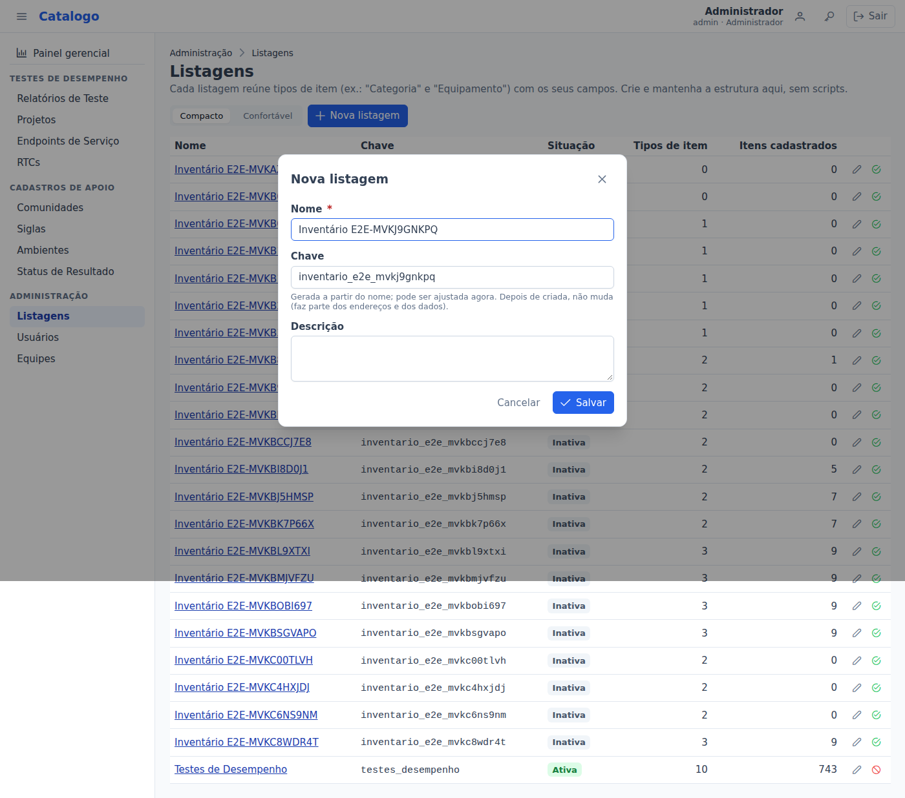

A tela da listagem abre em seguida. Ela ainda não tem tipos de item.

## 2. Criar os tipos de item

Clique em **Novo tipo de item**. Informe o nome no **singular** ("Equipamento") e no **plural** ("Equipamentos"): o plural aparece no
menu e no título da lista; o singular, em "Novo: Equipamento". Depois escolha o **escopo**:

- **Por equipe**: cada item pertence a uma equipe, e só ela o vê e altera. Use para o que cada equipe cadastra (os equipamentos).
- **Global**: os mesmos itens para todas as equipes, e só o administrador altera. Use para cadastros de apoio (as categorias).

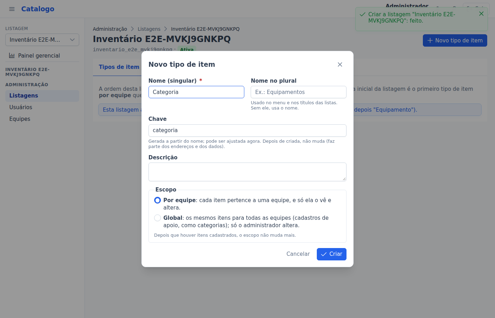

Crie primeiro os tipos que outros vão apontar (a **Categoria**) e depois os que apontam para eles (o **Equipamento**). A ordem da lista
de tipos é a ordem do menu: arraste pela alça (☰) ou use as setas. A **tela inicial** da listagem é o primeiro tipo **por equipe**.

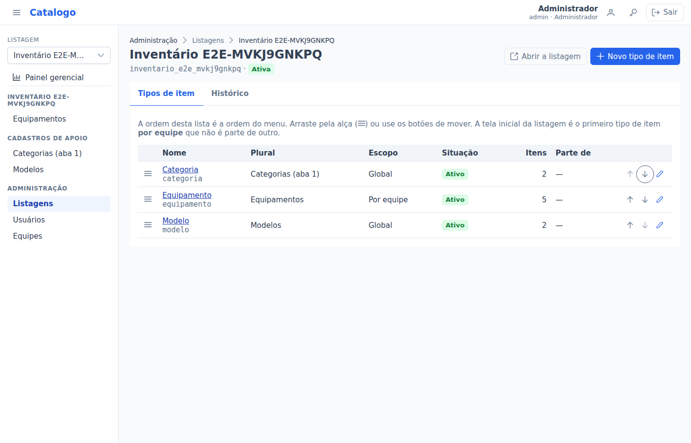

## 3. Criar os campos

Abra o tipo de item e vá na aba **Campos**. **Novo campo** abre um painel ao lado. Escolha o nome e o **tipo**; as opções do painel
mudam conforme o tipo:

| Tipo | Para quê | Opções |
|---|---|---|
| Texto curto | nome, código | tamanho máximo |
| Texto longo | observações, descrições (não vira coluna da lista) | — |
| Número inteiro / decimal | quantidade / valor em reais | decimal: total de dígitos e casas decimais |
| Sim ou não | uma marcação | — |
| Data / Data e hora | datas | — |
| Lista de opções | uma escolha entre opções fixas (situação) | as opções: adicionar, remover e mudar a ordem |
| Referência a outro tipo de item | apontar para um item de outro tipo (a categoria do equipamento) | qual tipo e o que fazer ao excluir |
| Endereço (URL) | links, que abrem numa nova aba | — |

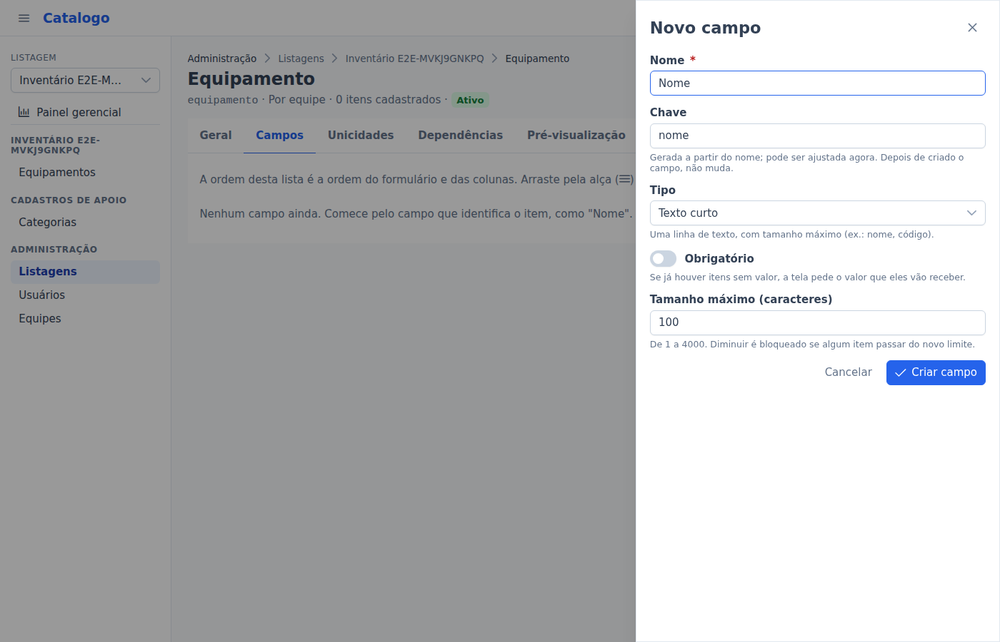

Toda **Referência** cria também uma ligação "de volta": no detalhe do item apontado aparece uma seção com os itens que apontam para
ele (no exemplo, o detalhe de uma categoria mostra os seus equipamentos, com "Ver todos na listagem" e "Novo Equipamento" já com a
categoria preenchida). Não é preciso configurar nada.

**Obrigatório** faz o formulário exigir o campo. Para uma **Lista de opções**, escreva cada opção na ordem em que deve aparecer:

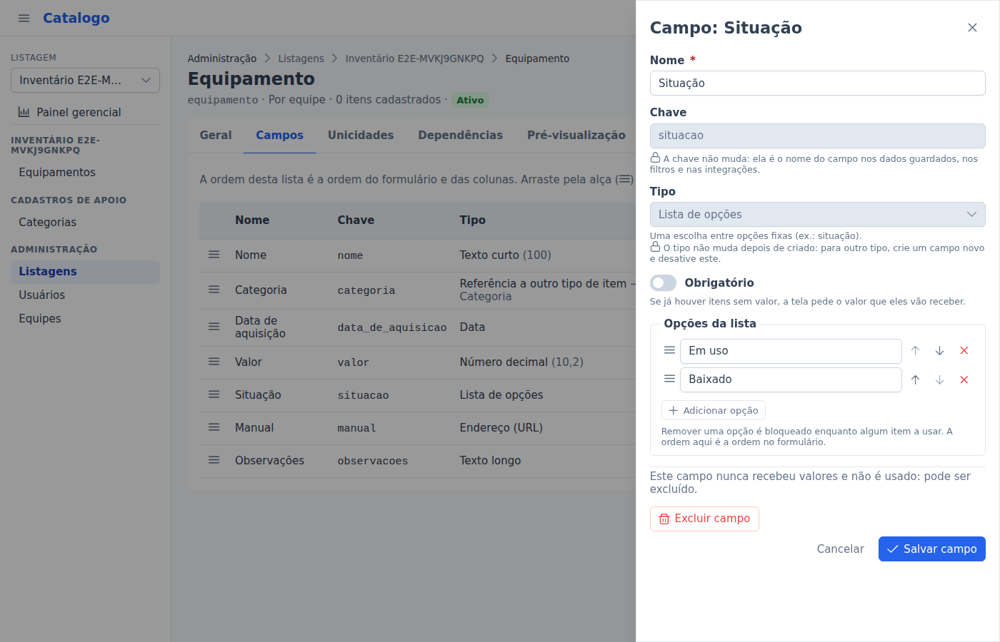

Para uma **Referência**, escolha o tipo de item apontado e o que acontece quando alguém tentar excluir o item apontado:

- **Restringir** (o mais seguro): a categoria só pode ser excluída quando nenhum equipamento apontar mais para ela;
- **Cascata**: excluir o item apontado exclui junto os que apontam para ele. Use para "partes" de um item. Com o campo obrigatório,
  o tipo vira uma **seção** dentro do detalhe do outro (como os cenários dentro do relatório de teste).

Um tipo **global** só pode apontar para outros globais.

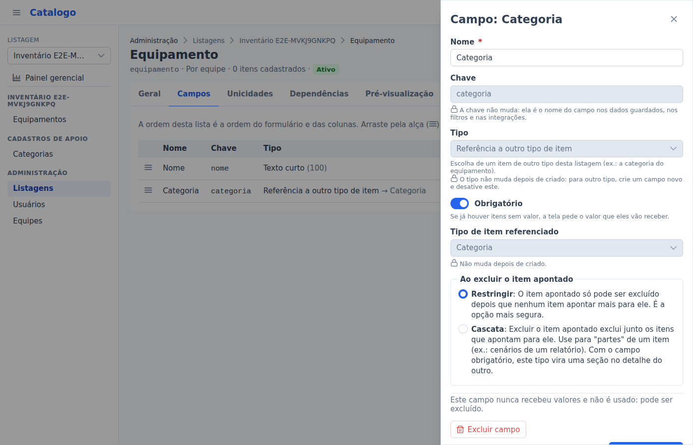

A tabela de campos mostra o tipo, se é obrigatório, a situação e **onde o campo é usado**. A ordem dos campos é a ordem do formulário
e das colunas: arraste pela alça ou use as setas.

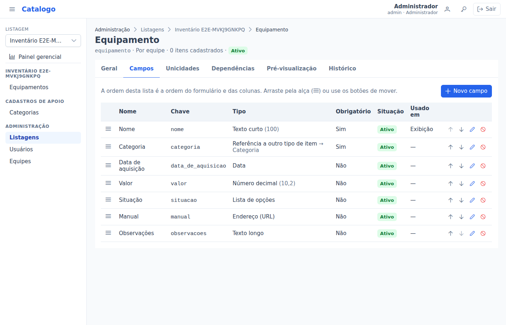

## 4. Escolher o campo de exibição

Na aba **Geral**, escolha o **campo de exibição**: o texto que representa cada item quando outro tipo aponta para ele (nos selects,
nas tabelas e no título do detalhe). Normalmente é o **Nome**. Sem ele, os itens aparecem como "(sem rótulo)".

## 5. Unicidades: impedir repetidos

Na aba **Unicidades**, escolha de 1 a 5 campos que não podem se repetir (ex.: o nome do equipamento). Maiúsculas e acentos não
contam ("Notebook" = "NOTEBOOK"). Nos tipos por equipe, a regra vale dentro de cada equipe.

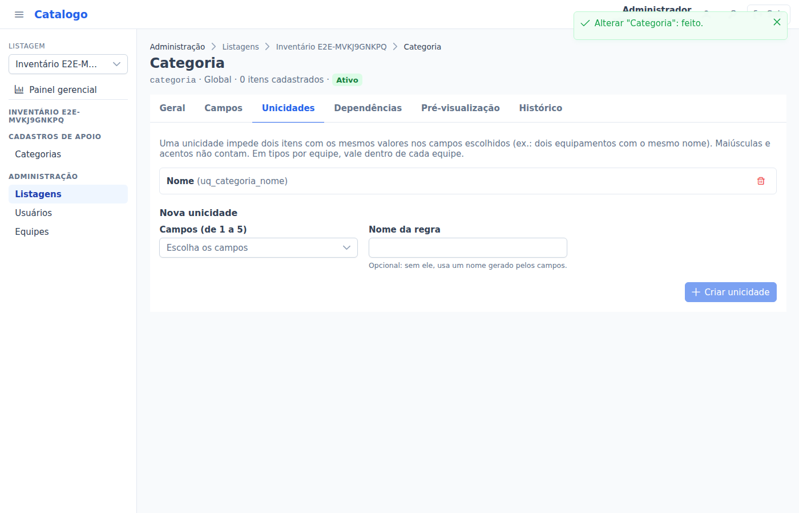

## 6. Dependências: filtrar as opções de um campo

Na aba **Dependências**, cada campo de referência pode ter as opções **filtradas** pelo que já foi escolhido no formulário. A regra é
montada numa frase; cada lista só mostra combinações possíveis, e embaixo aparece como o campo vai se comportar.

Exemplo: "As opções de **Modelo** mostram só os itens de **Modelos** cujo **Categoria** é igual ao valor escolhido em **Categoria**
neste mesmo formulário." No formulário, "Modelo" fica desabilitado até alguém escolher a categoria, e mostra só os modelos dela.

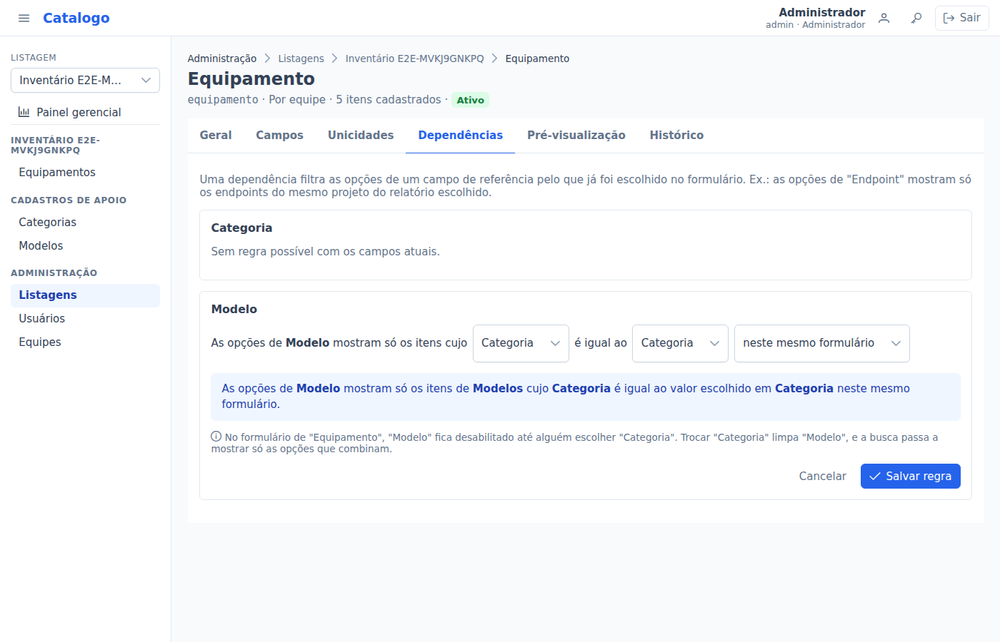

## 7. Conferir antes de liberar: a pré-visualização

A aba **Pré-visualização** mostra o formulário e as colunas da lista como as pessoas vão ver, sem gravar nada.

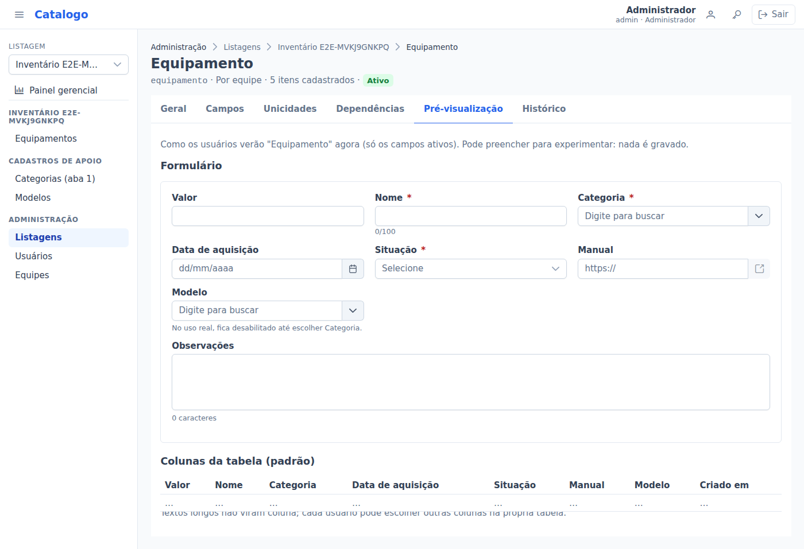

## 8. Habilitar as equipes

Uma listagem nova **nasce sem equipes**: só administradores a veem. Enquanto isso, a tela dela mostra a faixa **"Nenhuma equipe
habilitada: só administradores veem esta listagem"**. Assim você monta e confere a listagem antes de liberá-la.

Quando estiver pronta, clique em **Habilitar equipes** (na faixa) ou abra a aba **Equipes** da listagem, marque as equipes que vão
usá-la e clique em **Salvar equipes**. Só os membros dessas equipes veem a listagem no menu e cadastram nela, e só nessas equipes.
Uma equipe criada depois **não** entra sozinha: habilite-a aqui quando ela for usar a listagem.

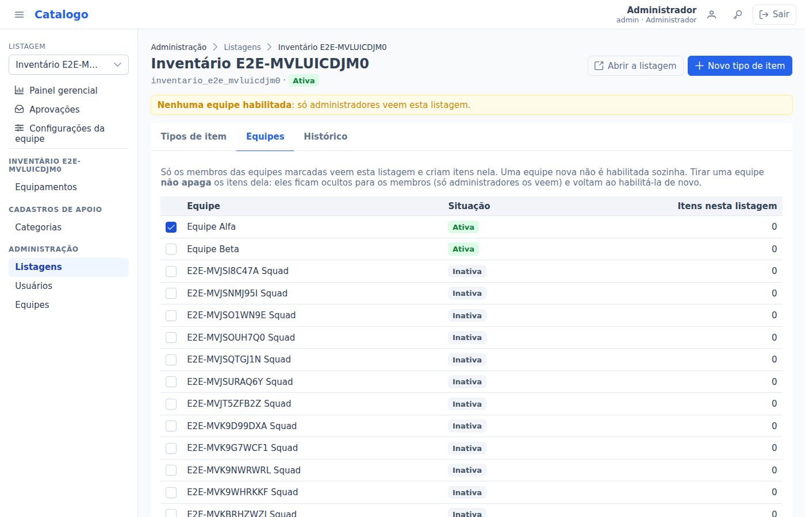

**Tirar uma equipe** que já tem itens na listagem é permitido: o sistema avisa quantos itens dela **ficam ocultos** para os membros
(só administradores continuam vendo). **Nada é apagado**: ao habilitar a equipe de novo, tudo volta. O detalhe de cada equipe
(Administração → Equipes) mostra em que listagens ela está habilitada.

## 9. Usar a listagem

Com mais de uma listagem visível, o **seletor de listagem** aparece no topo do menu. Cada pessoa vê só as listagens habilitadas para as
equipes dela. Escolha a listagem e cadastre os itens pelas telas
de sempre (Novo, filtros, ordenação, exportação). O sistema abre, da próxima vez, na última listagem usada.

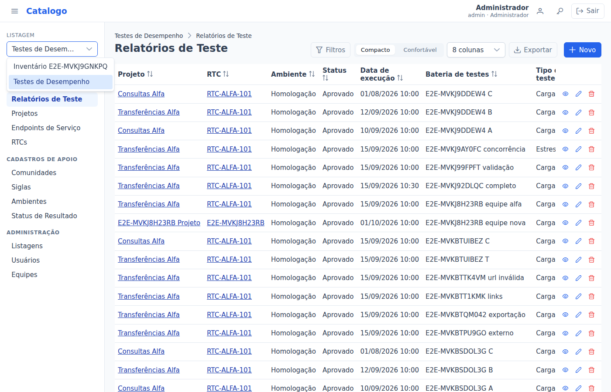

## Mudar uma listagem que já tem itens

Toda alteração é **conferida antes** de ser gravada. O sistema simula a alteração e:

- **grava direto**, se nada nos itens muda;
- **pede confirmação**, mostrando o efeito (ex.: "120 itens receberão o valor padrão");
- **pede um valor padrão**, se um campo vai ficar obrigatório e há itens sem valor nele (os já preenchidos não mudam);

  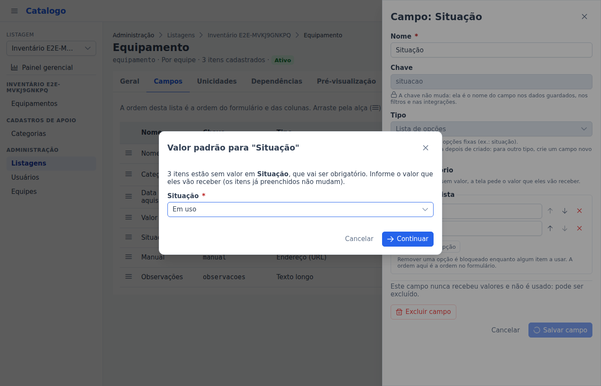

- **não deixa**, se a alteração deixaria itens inválidos. O relatório mostra quantos itens, exemplos (com link para cada um) e **o
  que fazer**. Nada é gravado.

  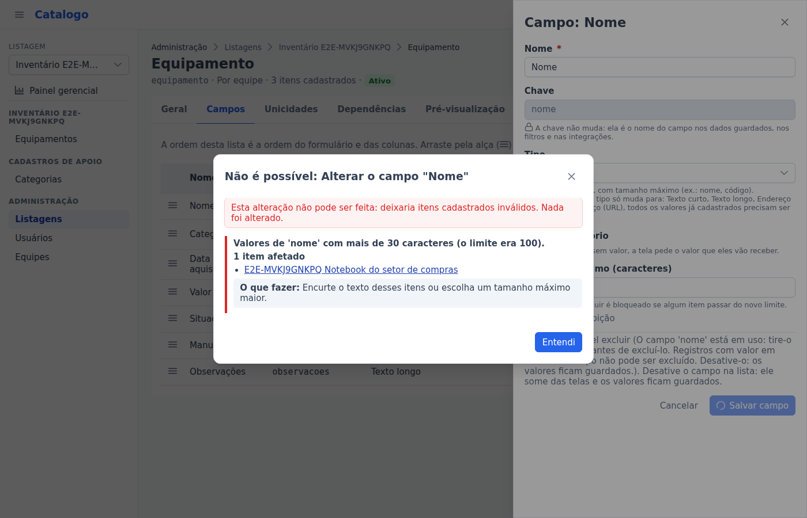

Se outra pessoa alterou a mesma estrutura enquanto você editava, o sistema avisa e recarrega a tela: confira e refaça.

### O que pode e o que não pode mudar depois

| Pode | Não pode (ou só com condições) |
|---|---|
| Nome, plural e descrição de listagens, tipos de item e campos | **Chaves** (nunca mudam) |
| Ordem dos tipos de item e dos campos | **Tipo do campo**: só de Texto curto para Texto longo, de Texto para Endereço (URL), e de Endereço para Texto longo. Para outro tipo, crie um campo novo e desative o antigo |
| Tornar obrigatório (com valor padrão para os vazios) ou opcional | **Diminuir o tamanho**, a precisão ou a escala: só se nenhum item passar do limite novo |
| Aumentar tamanho, precisão ou escala | **Remover uma opção da lista**: só se nenhum item a usar |
| Adicionar opções a uma lista | **Unicidade nova**: só se não houver repetidos (o relatório mostra quais) |
| Remover uma unicidade ou uma dependência | **Dependência nova**: só se os itens existentes combinarem com ela |
| Desativar e reativar campos, tipos de item e listagens | **Escopo** (global ou por equipe): só enquanto não houver itens |
| | **Excluir** um campo: só se ele nunca teve valores e não é usado; um tipo de item: só se nunca teve itens. Nos outros casos, **desative** |

**Desativar** não apaga nada: um campo desativado some das telas, mas os valores ficam guardados e voltam ao reativar. Um tipo de item
ou uma listagem desativada some para quem não é administrador; para o administrador, fica só para leitura.

Tudo o que muda fica na aba **Histórico** (da listagem e de cada tipo de item), com quem alterou, quando e o que mudou.
