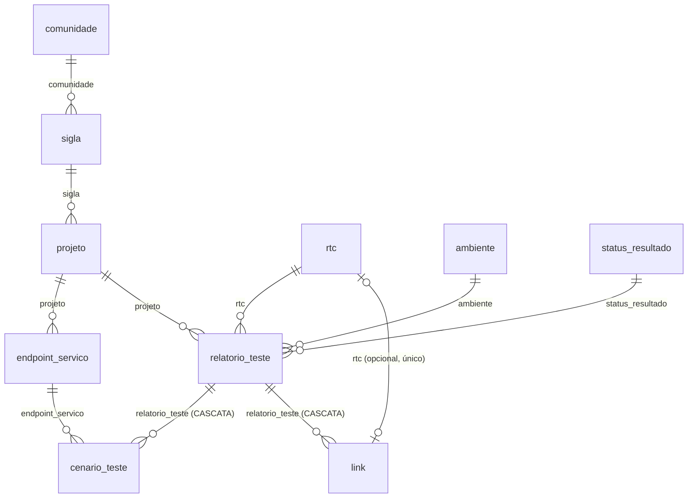

# Listagem: Testes de Desempenho

Exemplo de listagem configurada **só com metadados**, sem nenhuma linha de código específica.
Ela é criada pelo seed do [`V001`](../../database/scripts/V001__listagem_generica.sql).

> O próprio script avisa: obrigatoriedade e unicidades foram **inferidas** do diagrama original e
> precisam ser revisadas com a área de negócio.

- **Grupo**: `testes_desempenho` (Testes de Desempenho)
- **URL base**: `/api/v1/grupos/testes_desempenho/entidades`

## Escopo das entidades (a confirmar)

> ⚠️ **CLASSIFICAÇÃO A CONFIRMAR COM O NEGÓCIO.** Feita no script [`V003`](../../database/scripts/V003__usuarios_equipes_historico.sql)
> a partir do que parecem ser tabelas de apoio. Mudar depois exige um script novo e tratar os registros existentes
> ([ADR 0017](../adr/0017-escopo-global-ou-por-equipe-na-entidade.md)).

| Escopo | Entidades | Quem altera |
|---|---|---|
| **Global** (`EscopoEquipe = 0`) | `comunidade`, `sigla`, `ambiente`, `status_resultado` | só o ADMINISTRADOR. Todos veem |
| **Por equipe** (`EscopoEquipe = 1`) | `projeto`, `endpoint_servico`, `rtc`, `relatorio_teste`, `cenario_teste`, `link` | conforme o perfil, só nas suas equipes (RN26) |

Consequências práticas (RN29):
- um `projeto` aponta para uma `sigla` global, de qualquer equipe;
- um `relatorio_teste` só aponta para `projeto` e `rtc` da **mesma equipe**;
- a unicidade de `projeto` (sigla + nome) e de `rtc` vale dentro de cada equipe (RN09).

## Menu: ordem e nomes no plural (V008)

| Seção | Entidades, na `Ordem` | Plural |
|---|---|---|
| Testes de Desempenho (por equipe) | 1 `relatorio_teste` (a tela inicial), 2 `projeto`, 3 `endpoint_servico`, 4 `rtc` | Relatórios de Teste, Projetos, Endpoints de Serviço, RTCs |
| Cadastros de apoio (globais) | 5 `comunidade`, 6 `sigla`, 7 `ambiente`, 8 `status_resultado` | Comunidades, Siglas, Ambientes, Status de Resultado |
| Filhas (fora do menu, seções do relatório) | 9 `cenario_teste`, 10 `link` | Cenários de Teste, Links |

`link.url` e `projeto.url_projeto` são do tipo **URL** desde o `V007` ([ADR 0042](../adr/0042-tipo-de-dado-url.md)).

## Aprovação e avaliação

Nenhuma das duas vem ligada: o seed não cria `ConfiguracaoEntidadeEquipe` (aprovação, RN33) nem `ModeloAvaliacao`
(avaliação, RN40). Por enquanto esta listagem **não usa avaliação**. Se uma equipe quiser, o GESTOR dela configura pela
API, por entidade por equipe (ex.: `relatorio_teste`). As entidades globais não aceitam nenhuma das duas.

## Entidades e relacionamentos



## Campos

Legenda: **\*** = obrigatório. Referências: R = RESTRINGIR, C = CASCATA. O campo de exibição (rótulo) aparece em **negrito**.

| Entidade | Campos (na ordem) |
|---|---|
| `comunidade` | **`nome`**\* TEXTO(100) |
| `sigla` | `comunidade`\* → comunidade (R) · **`codigo_sigla`**\* TEXTO(20) |
| `projeto` | `sigla`\* → sigla (R) · **`nome`**\* TEXTO(150) · `url_projeto` URL |
| `endpoint_servico` | `projeto`\* → projeto (R) · **`nome_servico`**\* TEXTO(150) · `metodo`\* TEXTO(50) · `endpoint_url_fila`\* TEXTO(255) · `ativo`\* BOOLEANO |
| `rtc` | **`rtc_externo_id`**\* TEXTO(20) |
| `ambiente` | **`nome`**\* TEXTO(50) · `servidor_gerenciador_filas` TEXTO(255) · `configuracoes_infraestrutura` TEXTO_LONGO |
| `status_resultado` | **`descricao`**\* TEXTO(30) |
| `relatorio_teste` | `projeto`\* → projeto (R) · `rtc`\* → rtc (R) · `ambiente`\* → ambiente (R) · `status_resultado`\* → status_resultado (R) · `data_execucao`\* DATA_HORA · **`bateria_testes`**\* TEXTO(50) · `tipo_teste`\* TEXTO(50) · `executado_por`\* TEXTO(150) · `contexto` · `objetivo` · `apontamentos` · `conclusao` (TEXTO_LONGO) |
| `cenario_teste` | `relatorio_teste`\* → relatorio_teste (C) · `endpoint_servico`\* → endpoint_servico (R) · **`numero_cenario`**\* · `usuarios_virtuais`\* · `tempo_medio_resposta_ms`\* · `percentil_95_ms`\* (INTEIRO) · `vazao_media_tps`\* DECIMAL(18,2) · `taxa_erro_percentual`\* DECIMAL(5,2) |
| `link` | `relatorio_teste`\* → relatorio_teste (C) · `rtc` → rtc (R) · **`texto_exibicao`**\* TEXTO(100) · `url`\* URL |

São 10 entidades e 40 campos.

## Unicidades (RN09)

| Restrição | Entidade | Campos |
|---|---|---|
| `uq_comunidade_nome` | comunidade | `nome` |
| `uq_sigla_codigo` | sigla | `codigo_sigla` |
| `uq_projeto_sigla_nome` | projeto | `sigla`, `nome` (composta) |
| `uq_rtc_externo_id` | rtc | `rtc_externo_id` |
| `uq_ambiente_nome` | ambiente | `nome` |
| `uq_status_descricao` | status_resultado | `descricao` |
| `uq_cenario_relatorio_numero` | cenario_teste | `relatorio_teste`, `numero_cenario` (composta) |
| `uq_link_rtc` | link | `rtc`: um RTC tem no máximo um link. Link sem RTC não conflita (RN10) |

Como os textos são normalizados, `"Comunidade Ágil"` e `"comunidade agil"` são o mesmo nome.

## Dependência (RN08)

`cenario_teste.endpoint_servico` só aceita endpoints do **mesmo projeto do relatório** do cenário:

```
endpoint_servico.projeto  ==  relatorio_teste.projeto
        (CampoAlvo)              (CampoOrigem, via cenario_teste.relatorio_teste)
```

## Exemplo de cadastro, em ordem

Cada passo usa o `id` devolvido pelos anteriores:

1. `POST .../comunidade/registros` `{ "nome": "Comunidade Ágil" }`
2. `POST .../sigla/registros` `{ "comunidade": "<id 1>", "codigo_sigla": "CAG" }`
3. `POST .../projeto/registros` `{ "sigla": "<id 2>", "nome": "Portal" }`
4. `POST .../endpoint_servico/registros` `{ "projeto": "<id 3>", "nome_servico": "consulta", "metodo": "POST", "endpoint_url_fila": "/api/consulta", "ativo": true }`
5. `rtc`, `ambiente` e `status_resultado`: um campo texto cada
6. `POST .../relatorio_teste/registros` com `projeto`, `rtc`, `ambiente`, `status_resultado`, `data_execucao` (ex.: `"2026-10-21T14:30:00-03:00"`), `bateria_testes`, `tipo_teste` e `executado_por`
7. `POST .../cenario_teste/registros`: ver o exemplo completo em [modelo-de-dados.md](../modelo-de-dados.md#exemplo-um-cenário-de-teste-salvo)

## Exclusão (RN16)

| Excluir... | Resultado |
|---|---|
| `relatorio_teste` | exclui junto os seus `cenario_teste` e `link` (CASCATA). `rtc`, `projeto` e `endpoint_servico` ficam |
| `projeto` com `endpoint_servico` ou `relatorio_teste` | **409**: eles apontam para o projeto com RESTRINGIR |
| `rtc` usado por um `link` ou `relatorio_teste` | **409** (RESTRINGIR) |
| `endpoint_servico` usado por um `cenario_teste` | **409** (RESTRINGIR) |

Depois que um `link` é excluído, o RTC dele fica livre para outro link (`uq_link_rtc`).

## Opções do endpoint no formulário de cenário (RN21)

O `GET .../entidades` informa `"dependeDe": "relatorio_teste"` no campo `endpoint_servico` do cenário.
Quando o usuário escolhe o relatório, o front busca:

```
GET /api/v1/grupos/testes_desempenho/entidades/cenario_teste/campos/endpoint_servico/opcoes?dependeDe=<id do relatório>&busca=pix
```

e recebe só os endpoints do projeto do relatório, ordenados por `nome_servico` (o rótulo).
