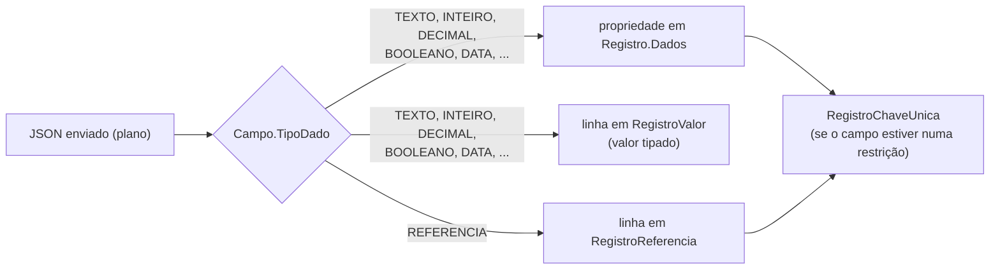
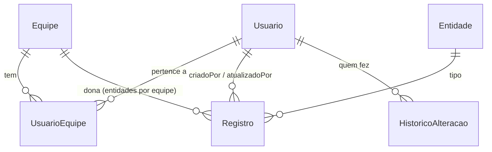
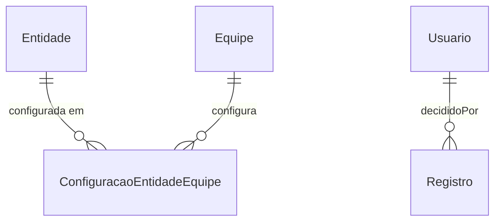
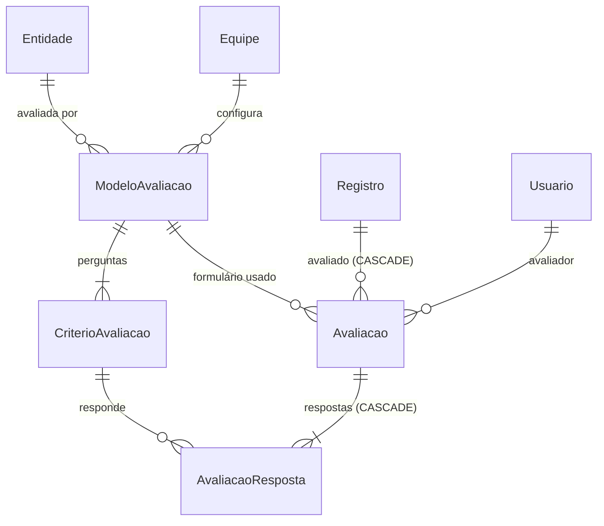
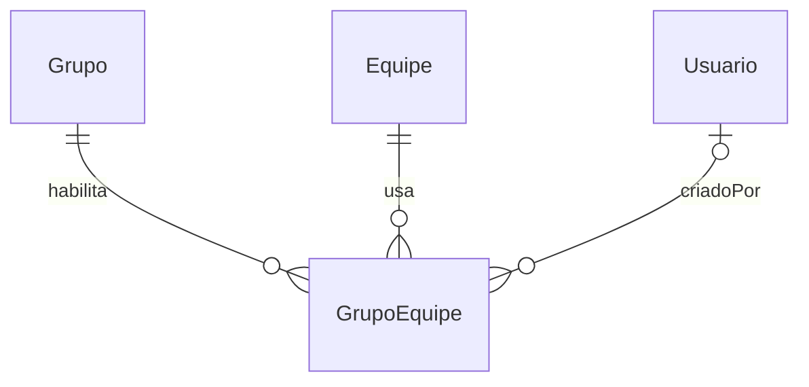
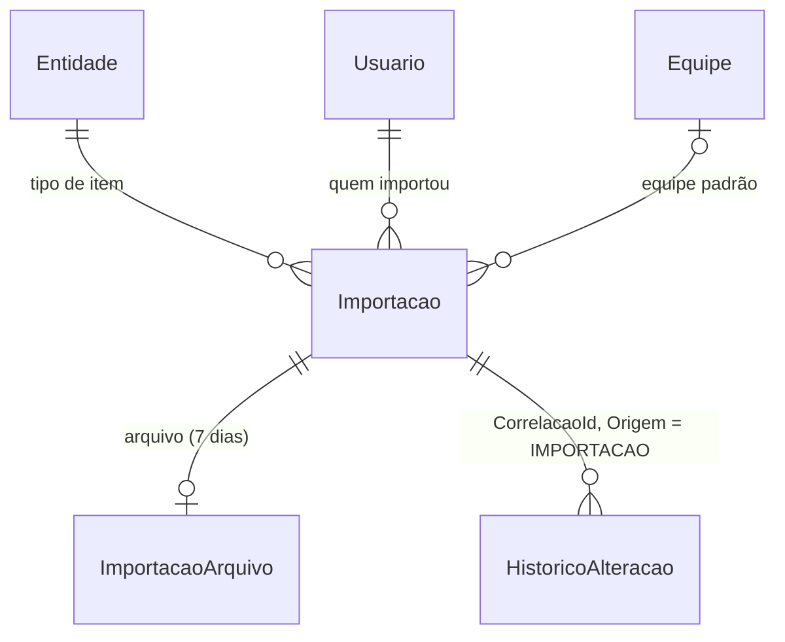

# Modelo de dados

A fonte da verdade são os scripts de [`database/scripts/`](../database/scripts/):
[`V001`](../database/scripts/V001__listagem_generica.sql) (metadados, dados e seed) e
[`V002`](../database/scripts/V002__registro_valor.sql) (`RegistroValor`) e
[`V003`](../database/scripts/V003__usuarios_equipes_historico.sql) (usuários, equipes, escopo e histórico), V004 (aprovação), V005 (avaliação) e
[`V006`](../database/scripts/V006__administracao_metadados.sql) (administração de metadados), V007 e V008 (tipo URL e plural) e
[`V009`](../database/scripts/V009__grupo_equipe.sql) (listagens habilitadas por equipe), V010 (ícone), V011 (importação) e
[`V012`](../database/scripts/V012__schema_catalogo.sql) (schema `catalogo`).
Este documento explica o modelo. Se algo aqui divergir dos scripts, **valem os scripts**, e este documento deve ser corrigido.

## Schema `catalogo` (V012)

**Todas as tabelas do Catálogo ficam no schema `catalogo`**, em todos os ambientes (desenvolvimento, testes e produção). O banco de
produção é compartilhado com outros sistemas, que têm tabelas de nomes genéricos em `dbo` (`Usuario`, `Equipe`, `Registro`): com
schema próprio, os nomes não colidem e o Catálogo não lê nem altera nada fora dele. As tabelas deste documento são, portanto,
`catalogo.Grupo`, `catalogo.Registro`, `catalogo.Usuario` e assim por diante, inclusive a `catalogo.__VersaoSchema`.

- O `V012` moveu as 23 tabelas de `dbo` para `catalogo` com `ALTER SCHEMA ... TRANSFER` (os dados, as chaves e os índices vão junto,
  sem cópia) e acrescentou `__VersaoSchema.Observacao`. Os scripts novos escrevem `catalogo.` em todos os objetos.
- A aplicação acessa pelo papel de banco `catalogo_aplicacao`: `SELECT`, `INSERT`, `UPDATE`, `DELETE` e `EXECUTE` no schema
  `catalogo`, e nada mais (sem DDL, sem outros schemas).
- No EF Core, o schema vem de uma constante só (`SchemaBanco.Nome`), aplicada por `HasDefaultSchema`.
- Em produção, os DBAs instalam a estrutura por um pacote consolidado ([`database/entrega/`](../database/entrega/2026-10-26-instalacao-inicial/README.md)),
  equivalente ao resultado de todos os scripts `V`, criado direto no schema `catalogo`.

O banco tem duas camadas:

1. **Metadados**: descrevem *o que* pode ser cadastrado (tipos de item e seus campos).
2. **Dados**: os itens cadastrados de fato.

O motivo desse desenho genérico está em [adr/0001](adr/0001-modelo-generico-eav-json.md).

## Metadados

| Tabela | Uma linha é... | Colunas importantes |
|---|---|---|
| `Grupo` | uma listagem (ex.: Testes de Desempenho) | `Chave` (usada na URL, única) |
| `Entidade` | um tipo de item (ex.: `projeto`, `cenario_teste`) | `GrupoId`, `Chave` (única no grupo), `Nome` (singular) e `NomePlural` (V008), `CampoExibicaoId` (campo usado como rótulo), `EscopoEquipe` (1 = por equipe, 0 = global, RN27), `Ordem` (do menu) |
| `Campo` | um campo de uma entidade | `Chave` (nome no JSON), `TipoDado`, `Obrigatorio`, `Ativo`, `Ordem` e os atributos por tipo (abaixo) |
| `CampoDependencia` | uma regra "as opções deste campo dependem de outro" | `CampoId`, `CampoViaId`, `CampoOrigemId`, `CampoAlvoId` (ver [RN08](regras-de-negocio.md#rn08--campos-dependentes)) |
| `RestricaoUnica` | uma regra de unicidade de uma entidade | `Nome` (ex.: `uq_comunidade_nome`) |
| `RestricaoUnicaCampo` | um campo que faz parte de uma restrição | `RestricaoUnicaId`, `CampoId` (não tem coluna de ordem: a ordem usada é `Campo.Ordem`) |

### Atributos de `Campo` por tipo (garantidos por CHECK no banco)

| `TipoDado` | Atributo obrigatório | CHECK |
|---|---|---|
| `TEXTO` | `TamanhoMaximo` entre 1 e 4000 | `CK_Campo_Texto` |
| `DECIMAL` | `Precisao` (1 a 38) e `Escala` (≤ Precisao, **≤ 10**, e `Precisao − Escala` ≤ 28, RN22). Os dois ficam nulos nos outros tipos | `CK_Campo_Decimal` (recriado no V002) |
| `LISTA` | `Opcoes`, um array JSON (ex.: `["GET","POST"]`). Fica nulo nos outros tipos | `CK_Campo_Lista` |
| `REFERENCIA` | `EntidadeReferenciadaId` e `AcaoExclusao` (`RESTRINGIR`/`CASCATA`). Ficam nulos nos outros tipos | `CK_Campo_Referencia` |
| `TEXTO_LONGO`, `INTEIRO`, `BOOLEANO`, `DATA`, `DATA_HORA`, `URL` | nenhum (a URL tem o limite fixo de 2000 caracteres, RN04) | `CK_Campo_TipoDado` (com `URL` desde o V007) |

## Dados

| Tabela | Uma linha é... | Destaques |
|---|---|---|
| `Registro` | um item cadastrado | `Dados` (JSON só com os campos **simples**), `EquipeId` (nula nas entidades globais), `CriadoEm`/`CriadoPorId`, `AtualizadoEm`/`AtualizadoPorId`, `Versao` (`rowversion`) |
| `RegistroReferencia` | o valor de **um campo REFERENCIA** de um registro | PK (`RegistroOrigemId`, `CampoId`): cada campo aponta para no máximo um registro |
| `RegistroChaveUnica` | o hash de **uma restrição única** de um registro | UNIQUE (`RestricaoUnicaId`, `ValorHash`) barra duplicados ([adr/0005](adr/0005-unicidade-por-hash.md)) |
| `RegistroValor` | o valor **tipado** de **um campo simples preenchido** de um registro | PK (`RegistroId`, `CampoId`). Projeção de `Dados` para filtrar e ordenar ([adr/0013](adr/0013-registro-valor.md)) |

`id`, `criadoEm`, `atualizadoEm` e `versao` são **colunas de sistema** do `Registro`: não são
cadastrados como `Campo` (RN13) e são chaves reservadas (RN14).

### `RegistroValor`: valores tipados

Cada campo simples preenchido também vira uma linha em `RegistroValor`, com o valor na coluna do seu tipo:

| `TipoDado` | Coluna | Exemplo |
|---|---|---|
| TEXTO, TEXTO_LONGO, LISTA, URL | `ValorTexto nvarchar(max)` | `"Comunidade Ágil"`, `"https://grafana.interno/d/abc"` |
| INTEIRO, DECIMAL | `ValorNumero decimal(38,10)` | `35.5000000000` |
| DATA, DATA_HORA | `ValorData datetime2` (DATA_HORA em UTC) | `2026-10-21 17:30:00` |
| BOOLEANO | `ValorBooleano bit` | `1` |

- REFERENCIA não entra (já está em `RegistroReferencia`). Campo vazio não gera linha.
- FKs compostas: `(RegistroId, EntidadeId) → Registro` com CASCADE, e `(CampoId, EntidadeId) → Campo`
  (o campo é sempre da entidade do registro). O CHECK `CK_RegistroValor_UmValor` exige exatamente uma coluna preenchida.
- É gravada **sempre junto** com `Registro.Dados`, no mesmo `SaveChanges`. A API devolve `Dados`;
  `RegistroValor` serve só para buscar, ordenar e montar rótulos.

### Como um campo vira dado



- **Campo simples** → propriedade no JSON `Registro.Dados`, já **normalizada** (ex.: texto sem
  espaços nas pontas, data e hora em UTC, decimal com a escala do campo).
- **Campo REFERENCIA** → **nunca** fica no JSON. Vira uma linha em `RegistroReferencia`, com FKs
  compostas reais, então o próprio banco garante que:
  - o campo pertence à entidade do registro de origem (`FK_RegistroReferencia_CampoOrigem`);
  - o registro de destino é da entidade que o campo referencia (`FK_RegistroReferencia_Destino` + `FK_RegistroReferencia_CampoDestino`).
- Para o cliente o registro é **plano**: o POST/PUT recebe e o GET devolve os campos simples e as
  referências juntos no mesmo objeto `dados`. Na entrada a referência é o GUID; na saída é
  `{ "id", "rotulo" }` (RN20).

### Exemplo: um cenário de teste salvo

O cliente envia:

```json
POST /api/v1/grupos/testes_desempenho/entidades/cenario_teste/registros
{
  "relatorio_teste": "6f1c0d5e-2b7a-4c11-9a3e-1d2c3b4a5f60",
  "endpoint_servico": "a9e8d7c6-b5a4-4f3e-8d2c-1b0a9f8e7d6c",
  "numero_cenario": 1,
  "usuarios_virtuais": 100,
  "tempo_medio_resposta_ms": 250,
  "percentil_95_ms": 480,
  "vazao_media_tps": 35.5,
  "taxa_erro_percentual": 0.25
}
```

No banco fica assim:

**`Registro`** (1 linha)

| Id | EntidadeId | Dados |
|---|---|---|
| `c3...01` | *(id de cenario_teste)* | `{"numero_cenario":1,"usuarios_virtuais":100,"tempo_medio_resposta_ms":250,"percentil_95_ms":480,"vazao_media_tps":35.50,"taxa_erro_percentual":0.25}` |

Repare que `vazao_media_tps` virou `35.50` (escala 2) e que **não há** `relatorio_teste` nem `endpoint_servico` no JSON.

**`RegistroReferencia`** (2 linhas, uma por campo REFERENCIA preenchido)

| RegistroOrigemId | CampoId | RegistroDestinoId | EntidadeDestinoId |
|---|---|---|---|
| `c3...01` | *(campo relatorio_teste)* | `6f1c...5f60` | *(id de relatorio_teste)* |
| `c3...01` | *(campo endpoint_servico)* | `a9e8...7d6c` | *(id de endpoint_servico)* |

**`RegistroChaveUnica`** (1 linha, da restrição `uq_cenario_relatorio_numero`)

| RestricaoUnicaId | RegistroId | ValorHash |
|---|---|---|
| *(id de uq_cenario_relatorio_numero)* | `c3...01` | `SHA-256("6f1c0d5e-2b7a-4c11-9a3e-1d2c3b4a5f60" + "\u001f" + "1")` |

**`RegistroValor`** (6 linhas, uma por campo simples)

| CampoId | ValorNumero |
|---|---|
| *(numero_cenario)* | `1.0000000000` |
| *(usuarios_virtuais)* | `100.0000000000` |
| *(tempo_medio_resposta_ms)* | `250.0000000000` |
| *(percentil_95_ms)* | `480.0000000000` |
| *(vazao_media_tps)* | `35.5000000000` |
| *(taxa_erro_percentual)* | `0.2500000000` |

E o GET devolve (as referências com o rótulo do registro apontado, RN20):

```json
{
  "id": "c3...01",
  "criadoEm": "2026-10-21T17:30:00.1234567Z",
  "atualizadoEm": null,
  "versao": "AAAAAAAAB9I=",
  "dados": {
    "relatorio_teste": { "id": "6f1c0d5e-2b7a-4c11-9a3e-1d2c3b4a5f60", "rotulo": "Bateria 1" },
    "endpoint_servico": { "id": "a9e8d7c6-b5a4-4f3e-8d2c-1b0a9f8e7d6c", "rotulo": "consulta" },
    "numero_cenario": 1,
    "usuarios_virtuais": 100,
    "tempo_medio_resposta_ms": 250,
    "percentil_95_ms": 480,
    "vazao_media_tps": 35.50,
    "taxa_erro_percentual": 0.25
  }
}
```

As colunas de sistema ficam fora de `dados` para não colidir com um campo cuja chave seja, por exemplo, `id`.

## Acesso e histórico (V003)

| Tabela | Uma linha é... | Destaques |
|---|---|---|
| `Equipe` | uma equipe | `Nome` único, `Ativa`. Nunca é excluída (RN31) |
| `Usuario` | uma pessoa que acessa o sistema | `Matricula` única, `SenhaHash` (PBKDF2, nunca sai do banco), `Perfil` (CHECK: EXTERNO, INTERNO, GESTOR, ADMINISTRADOR), `Ativo`, `DeveTrocarSenha`, `TentativasFalhas`, `BloqueadoAte`, `UltimoAcessoEm`. Nunca é excluído (RN31) |
| `UsuarioEquipe` | um vínculo usuário ↔ equipe | PK (`UsuarioId`, `EquipeId`). Um usuário pode ter várias equipes. Vínculo com equipe inativa não dá permissão |
| `HistoricoAlteracao` | uma alteração de um alvo | `AlvoTipo` (REGISTRO, USUARIO, EQUIPE, CONFIGURACAO desde a V004, e MODELO_AVALIACAO e AVALIACAO desde a V005), `AlvoId` (**sem FK**, sobrevive à exclusão), `EntidadeId`, `EquipeId`, `Operacao`, `UsuarioId` + `UsuarioMatricula`, `OcorridoEm`, `CorrelacaoId`, `DadosAntes`/`DadosDepois` (JSON, CHECK `ISJSON`) e, desde a V011, `Origem` (nula = cadastro manual; `IMPORTACAO` = gravado por uma importação de planilha, RN97) |



O índice `IX_Registro_Entidade_Equipe (EntidadeId, EquipeId)` atende o filtro de equipe das listagens,
e o `IX_HistoricoAlteracao_Alvo (AlvoTipo, AlvoId, OcorridoEm)` atende a consulta do histórico.

## Aprovação (V004)

| Tabela / coluna | O que é | Destaques |
|---|---|---|
| `ConfiguracaoEntidadeEquipe` | a configuração de uma entidade numa equipe | PK (`EntidadeId`, `EquipeId`), `RequerAprovacao` (padrão 0), `AtualizadoPorId`, `AtualizadoEm`. Sem linha = aprovação desligada ([RN33](regras-de-negocio.md#rn33--aprovação-ativável-por-entidade-e-equipe)) |
| `Registro.SituacaoAprovacao` | a situação do registro | CHECK: PENDENTE, APROVADO, REJEITADO. Padrão **APROVADO**: os registros existentes continuam valendo |
| `Registro.DecididoPorId`, `DecididoEm`, `JustificativaDecisao` | a **última** decisão | nulas até a primeira decisão. As anteriores ficam no histórico |
| `HistoricoAlteracao.Justificativa` | a justificativa de uma decisão | só nas operações APROVACAO e REJEICAO |

No histórico, a V004 acrescenta as operações **APROVACAO** e **REJEICAO** e o alvo **CONFIGURACAO**
(`AlvoId` = equipe, `EntidadeId` = entidade configurada; os CHECKs foram recriados). O índice
`IX_Registro_Situacao_Equipe (SituacaoAprovacao, EquipeId, CriadoEm)` atende a fila de pendentes.



## Avaliação de itens (V005)

Tabelas **relacionais tipadas** (sem JSON), para médias e contagens serem LINQ simples
([ADR 0021](adr/0021-avaliacao-configuravel-com-tabelas-tipadas.md), RN40 a RN48).

| Tabela | Uma linha é... | Destaques |
|---|---|---|
| `ModeloAvaliacao` | o formulário de avaliação de uma entidade numa equipe | `EntidadeId`, `EquipeId`, `Nome`, `Descricao`, `Ativo`, autores, `Versao` (`rowversion`). **Índice único filtrado** `UX_ModeloAvaliacao_Ativo (EntidadeId, EquipeId) WHERE Ativo = 1`: um ativo por entidade e equipe (RN41). Nunca é excluído |
| `CriterioAvaliacao` | uma pergunta do modelo | `Chave` (`^[a-z0-9_]+$`, única no modelo), `Nome`, `Tipo` (ESTRELAS, TEXTO), `Obrigatorio`, `Comentario` (NENHUM, OPCIONAL, OBRIGATORIO; TEXTO sempre NENHUM), `TamanhoMaximoTexto` (1 a 4000, padrão 2000), `Ordem`, `Ativo` |
| `Avaliacao` | a avaliação de **um usuário** sobre **um registro**, num modelo | UNIQUE (`RegistroId`, `ModeloAvaliacaoId`, `UsuarioId`) (RN45). FK para `Registro` com **ON DELETE CASCADE**. `Versao` (`rowversion`) |
| `AvaliacaoResposta` | a resposta a um critério | PK (`AvaliacaoId`, `CriterioAvaliacaoId`). `Estrelas` (`tinyint`, 1 a 5) e/ou `Texto` (o texto livre ou o comentário da nota). CASCADE a partir da `Avaliacao` |



### Exemplo: a mesma entidade, três equipes

O Relatório de Teste avaliado de três jeitos diferentes:

| Equipe | `ModeloAvaliacao` | `CriterioAvaliacao` |
|---|---|---|
| A | "Avaliação da Equipe A" (ativo) | `qualidade` ESTRELAS, sem comentário |
| B | "Avaliação da Equipe B" (ativo) | `qualidade` ESTRELAS (comentário OBRIGATORIO), `clareza` ESTRELAS (OPCIONAL), `tempo_execucao` ESTRELAS, `cobertura` ESTRELAS (OBRIGATORIO), `observacoes` TEXTO |
| C | nenhum | — (os relatórios de C não são avaliados; `avaliacao` vem nulo) |

Uma avaliação na equipe B, do usuário `interno.b`:

```text
Avaliacao          (Id = av1, RegistroId = relatorio-b-1, ModeloAvaliacaoId = modelo-b, UsuarioId = interno.b)
AvaliacaoResposta  (av1, qualidade,   Estrelas = 4, Texto = 'Resultados consistentes com a bateria anterior')
AvaliacaoResposta  (av1, clareza,     Estrelas = 5, Texto = NULL)
AvaliacaoResposta  (av1, cobertura,   Estrelas = 3, Texto = 'Faltou o cenário de pico')
AvaliacaoResposta  (av1, observacoes, Estrelas = NULL, Texto = 'Repetir com 500 usuários')
```

A média de `qualidade` num relatório é um `AVG(CAST(Estrelas AS float))` sobre as respostas desse critério:
nada de JSON a interpretar. No histórico, os alvos novos são `MODELO_AVALIACAO` (`AlvoId` = equipe, como
`CONFIGURACAO`) e `AVALIACAO` (`AlvoId` = registro avaliado, para o histórico sobreviver à exclusão).

## Administração de metadados (V006)

A partir do V006, listagens novas são criadas **pela API** (`/api/v1/admin/metadados`, RN50 a RN77,
[administração de metadados](api/administracao-de-metadados.md)). Os scripts ficam só para schema.

| Tabela / coluna | O que é |
|---|---|
| `Grupo.Ativo`, `Entidade.Ativo` | desativado: some para os não-administradores e fica somente leitura para o administrador (RN75, RN77). Padrão 1 |
| `Entidade.Ordem` | ordem da entidade no menu (o seed recebeu a ordem do V001) |
| `Grupo.AtualizadoEm`, `Entidade.AtualizadoEm` | última alteração. Na entidade, muda também em toda alteração de campo, restrição ou dependência dela |
| `Grupo.Versao`, `Entidade.Versao` | `rowversion`: concorrência otimista da administração (RN52). A versão da entidade é a da estrutura inteira dela |
| `HistoricoAlteracao.AlvoTipo = METADADO` | uma linha por alteração de metadados: `AlvoId` = grupo, `EntidadeId` **sempre nulo** (a FK impediria excluir a entidade; ela vai nos dados), `registrosAfetados` nos dados quando houve escrita em massa |

Campos, restrições e dependências não ganharam colunas: `Campo.Ativo` já existia (V001). Os CHECKs de `Campo` (V001, V002) são as
regras de configuração que a administração valida antes de gravar (RN53).

O exemplo do Inventário (categoria global, equipamento por equipe) fica assim depois do passo a passo:

| Tabela | Linhas |
|---|---|
| `Grupo` | `inventario` |
| `Entidade` | `categoria` (EscopoEquipe 0, Ordem 1), `equipamento` (EscopoEquipe 1, Ordem 2), cada uma com `CampoExibicaoId` = o campo `nome` |
| `Campo` | categoria: `nome` TEXTO(50); equipamento: `nome` TEXTO(100), `categoria` REFERENCIA → categoria (RESTRINGIR), `data_aquisicao` DATA, `valor` DECIMAL(12,2) |
| `RestricaoUnica` + `RestricaoUnicaCampo` | `uq_categoria_nome` (nome), `uq_equipamento_nome` (nome) |

## Tipo URL e nome no plural (V007, V008)

| Script | O que muda |
|---|---|
| `V007__tipo_url.sql` | `CK_Campo_TipoDado` passa a aceitar `URL`. Converte `link.url` e `projeto.url_projeto` (grupo `testes_desempenho`) de `TEXTO_LONGO` para `URL`, **depois** de conferir que todos os valores são URLs (senão `THROW` com o campo e a quantidade, e nada muda). Os valores continuam em `RegistroValor.ValorTexto` ([ADR 0042](adr/0042-tipo-de-dado-url.md)) |
| `V008__entidade_nome_plural_e_ordem.sql` | `Entidade.NomePlural nvarchar(150) NULL` (nulo = as telas usam o `Nome`). Preenche os plurais do grupo `testes_desempenho` e ajusta a `Ordem`: Relatórios de Teste, Projetos, Endpoints de Serviço, RTCs, Comunidades, Siglas, Ambientes, Status de Resultado (e depois as filhas, Cenários de Teste e Links, que não vão para o menu) |

Os dois rodam de novo sem erro (só alteram o que ainda não foi alterado) e mudam a `Versao` das entidades tocadas. Como a API guarda
os metadados em cache por até 10 minutos, reinicie-a depois de aplicar.

## Listagens habilitadas por equipe (V009)

| Tabela | Uma linha é... | Destaques |
|---|---|---|
| `GrupoEquipe` | uma equipe habilitada numa listagem (RN90) | PK (`GrupoId`, `EquipeId`), FKs para `Grupo` e `Equipe`; `CriadoPorId` (FK `Usuario`, nulo na carga inicial) e `CriadoEm`. Índice `IX_GrupoEquipe_EquipeId` para o detalhe da equipe |



- Sem linha = a equipe não usa a listagem: os membros não a veem, e os itens que a equipe tiver nela ficam ocultos para eles (só o
  administrador os vê, RN92). Nada em `Registro` muda quando uma equipe sai ou volta.
- Listagem sem nenhuma linha: só o administrador a vê (RN93). Uma equipe **inativa** pode continuar com linhas.
- Quem grava é a API (`PUT /api/v1/admin/metadados/grupos/{grupo}/equipes`), com a lista completa: as linhas que saem são apagadas
  (é configuração, não histórico) e a mudança vai para o `HistoricoAlteracao` (`METADADO`, campo `equipes` com os nomes antes e
  depois), com a `Versao` do grupo alterada (RN52).
- **Carga inicial** (só com a tabela vazia, para rodar de novo sem devolver equipes que o administrador tirou): `testes_desempenho`
  para **todas** as equipes existentes; cada outra listagem para as equipes que já tinham itens nela. Na base local, em 24/10/2026:
  `testes_desempenho` com as 33 equipes; cada listagem de teste `inventario_e2e_*` com itens, com 1 equipe; as sem itens, nenhuma.
- Excluir um grupo (só sem entidades, RN77) apaga as linhas dele em `GrupoEquipe`.

## Importação de planilhas (V011)

| Tabela | Uma linha é... | Destaques |
|---|---|---|
| `Importacao` | uma importação de itens de UM tipo de item (RN97 a RN104) | `GrupoId`, `EntidadeId` (FK com CASCADE), `UsuarioId` (quem importou), `EquipePadraoId` (nula), `NomeArquivo`, `Formato` (CHECK: XLSX, CSV), `Situacao` (CHECK: ENVIADA, VALIDADA, CONCLUIDA, DESFEITA, EXPIRADA), `Opcoes`, `Mapeamento` e `Resumo` (JSON, CHECK `ISJSON`), `CorrelacaoId` (único: o mesmo das linhas de histórico dos itens gravados), `CriadoEm`, `ConcluidaEm`, `DesfeitaEm`, `Versao` (rowversion). Índice `IX_Importacao_Entidade_CriadoEm` para o histórico de importações |
| `ImportacaoArquivo` | o arquivo enviado | PK e FK `ImportacaoId` (ON DELETE CASCADE), `Conteudo` (`varbinary(max)`). Fica no banco, e não em disco, para funcionar igual em qualquer servidor. Separado para a listagem das importações não ler os arquivos. A limpeza apaga a linha depois de 7 dias (RN104) e mantém a `Importacao` |



- `Resumo` guarda os totais e o **resultado de cada linha** (situação, erros por coluna, referências resolvidas e o item criado ou
  alterado): a prévia paginada, o relatório e o desfazer leem dele. As linhas originais vêm do arquivo.
- Não há FK entre `Importacao` e os itens: o desfazer acha os itens criados pelo `Resumo` e confere as alterações posteriores pelo
  `HistoricoAlteracao` (linhas do item fora do `CorrelacaoId` da importação, RN103).

## Mapeamento no EF Core

Cada tabela tem uma classe `IEntityTypeConfiguration` em
`backend/src/Catalogo.Infrastructure/Persistencia/Configuracoes`, com os mesmos nomes de tabela, coluna,
PK, FK e UNIQUE do script. Exceções conscientes, comentadas no código:

- `UQ_Campo_Id_EntidadeReferenciada` é mapeada como índice único, não como chave alternativa, porque
  o EF não aceita chave alternativa com coluna anulável. Por isso a `FK_RegistroReferencia_CampoDestino`
  não é mapeada. O banco continua garantindo as duas.
- `UQ_RegistroChaveUnica_Valor` também é mapeada como índice único (e não chave alternativa), porque
  o PUT altera o `ValorHash` no lugar e o EF não deixa alterar coluna de chave alternativa.
- `GrupoEquipe` é mapeada como uma tabela de vínculo (`GrupoEquipeTabela`, na Infrastructure), sem navegação no domínio: o `Grupo`
  do domínio recebe só o conjunto `EquipesHabilitadas`, montado pelo `MetadadosProvider` (e guardado no cache dos metadados).
- `UQ_Equipe_Nome` também é mapeada como índice único: renomear a equipe altera o `Nome` no lugar (como chave
  alternativa, o PUT de equipe dava 500).
- `Usuario.Id` e `Equipe.Id`, como `Registro.Id`, são gerados pelo EF ao adicionar (GUID sequencial), para
  o histórico usar o id antes do `SaveChanges`.
- `Registro.Id` é gerado pelo EF (GUID sequencial) e não pelo `DEFAULT NEWSEQUENTIALID()` do banco,
  para referências e chaves únicas receberem o id no mesmo `SaveChanges`.
- `Importacao.Id` também é gerado pelo EF (não pelo `DEFAULT NEWSEQUENTIALID()`), para o `ImportacaoArquivo` entrar no mesmo
  `SaveChanges`; `Importacao.CriadoEm` é preenchido pela aplicação (o `TimeProvider`), não pelo `DEFAULT` do banco, e `Situacao` vai sem
  `HasDefaultValue` (sempre enviada). `HistoricoAlteracao.Origem` é texto no banco e um enum anulável no domínio (`OrigemHistorico`).
- `Registro.SituacaoAprovacao` é mapeada **sem** `HasDefaultValue`: o valor padrão do enum (0) é `Pendente`,
  e com valor padrão o EF deixaria de enviar `Pendente` no INSERT (o banco gravaria APROVADO).
- `ModeloAvaliacao.CriteriosAtivos` (filtro calculado de `Criterios`) é ignorado no EF (`Ignore`): sem isso, o EF a
  trataria como uma segunda navegação e procuraria uma coluna que não existe.
- `ModeloAvaliacao` → `CriterioAvaliacao` usa `ClientCascade` no EF (no banco a FK não tem CASCADE): critério sem
  respostas tirado do modelo (RN43) é excluído pelo EF. `Ativo`, `Obrigatorio` e afins **não** têm `HasDefaultValue`,
  pelo mesmo motivo da `SituacaoAprovacao`.
- `Entidade.EscopoEquipe`, `Entidade.Ativo`, `Grupo.Ativo`, `Campo.Ativo` e `Campo.Obrigatorio` são mapeados **sem** `HasDefaultValue`:
  com ele, o EF não enviaria `false` (o valor padrão do `bool`) no INSERT, e o banco gravaria 1. Uma entidade global criada pela
  API seria gravada como "por equipe".
- `Grupo.Versao` e `Entidade.Versao` são `IsRowVersion()`; a administração define o valor original lido pelo cliente, e o UPDATE
  sai com `WHERE Versao = @versaoLida` (RN52).
- Os CHECKs de `Campo` não são mapeados: o EF não cria schema ([adr/0003](adr/0003-schema-por-scripts-sql.md)).
