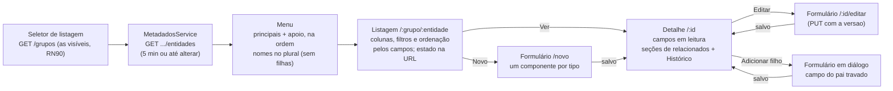
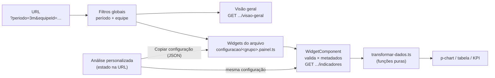
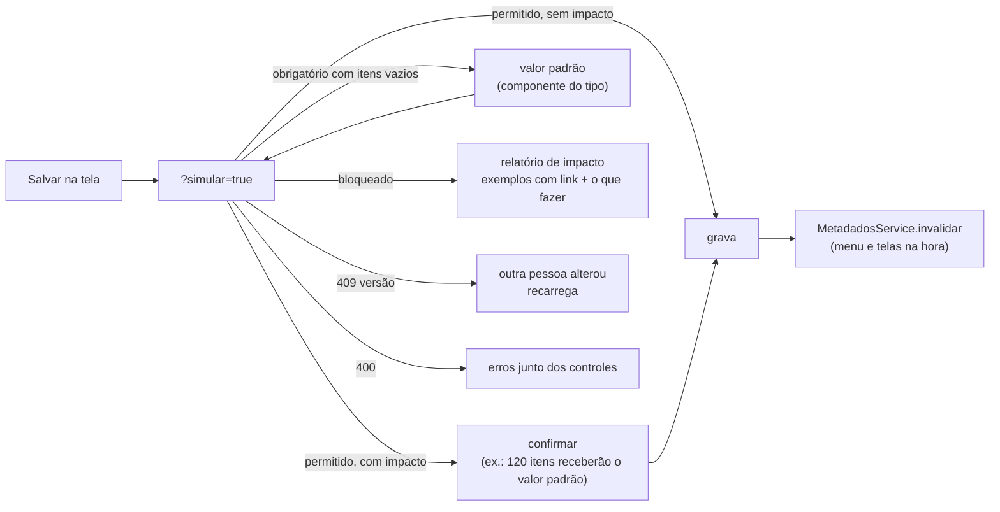

# Front-end: telas montadas pelos metadados

O front (Angular 20 + PrimeNG, [ADR 0033](adr/0033-angular-20-com-primeng.md)) não tem tela escrita à mão por tipo
de item: **listagem, filtros, formulário e detalhe são genéricos** e se montam a partir de
`GET /api/v1/grupos/{grupo}/entidades` ([ADR 0034](adr/0034-front-dirigido-por-metadados.md)). Como rodar e testar:
[`README.md`](../README.md); regras para quem mexe no código: [`AGENTS.md`](../AGENTS.md).

Caminhos marcados com **(back-end)** ficam no repositório do back-end (regras de negócio, guia da API e os ADRs que não estão em
[`adr/`](adr/README.md)).

## Fluxo



## Tipo de dado → componente

| Tipo | Componente (em `shared/campos/`) | Valor no formulário | Para a API |
|---|---|---|---|
| TEXTO | input com limite (`tamanhoMaximo`) e contador | texto | texto sem espaços nas pontas |
| TEXTO_LONGO | textarea com contador: 4 linhas, cresce sozinha até ~16 e depois rola; embaixo do grid, na largura toda | texto | idem |
| URL | input `type="url"` com a validação da RN04 e o botão "Abrir … numa nova aba" (só com URL válida) | texto | texto sem espaços nas pontas |
| INTEIRO | `p-inputnumber` sem casas | número | número |
| DECIMAL | `p-inputnumber` com a `escala` do campo | número | número (ponto decimal) |
| BOOLEANO | toggle | true/false | true/false |
| DATA | datepicker `dd/mm/aaaa` | Date | `"aaaa-mm-dd"` |
| DATA_HORA | datepicker com hora | Date (hora local) | ISO com o fuso do navegador (`...-03:00`) |
| LISTA | select com as `opcoes` | texto | texto |
| REFERENCIA | select com **busca no servidor** (`.../campos/{campo}/opcoes?busca=&dependeDe=&equipeId=`) | `{ id, rotulo }` | o `id` |

As validações do formulário vêm dos metadados (obrigatório, tamanho, faixa do INTEIRO, escala e dígitos do DECIMAL, opções da
LISTA, URL http/https), iguais às do back-end (RN03, RN04).

**Layout do formulário** (`montador-formulario.ts` → `layoutDoFormulario`): os campos curtos no grid de cima, na ordem dos metadados;
os `TEXTO_LONGO` embaixo, um por linha, na largura toda. Os erros 400 do servidor (`errors` por campo) aparecem embaixo do campo; os sem campo,
no topo. 409 `CONFLITO_UNICIDADE` marca os campos da restrição; 409 `CONFLITO_CONCORRENCIA` oferece recarregar (ou copiar os dados
antes).

## Filtros por tipo

Os filtros geram os parâmetros da API (RN18) e ficam na URL ([ADR 0037](adr/0037-estado-da-listagem-na-url.md)):

| Tipo | Filtro | Parâmetro |
|---|---|---|
| TEXTO, TEXTO_LONGO, URL | contém | `chave.contem=` |
| LISTA, BOOLEANO | igual | `chave=` |
| INTEIRO, DECIMAL, DATA, DATA_HORA | intervalo de/até | `chave.de=`, `chave.ate=` (DATA_HORA: o dia inteiro) |
| REFERENCIA | igual, com select com busca | `chave=<id>` |

As opções do filtro REFERENCIA vêm da **listagem da entidade apontada** (`<campoExibicao>.contem=<busca>`), não do endpoint de
opções: ele exige a equipe do registro (RN21) para o administrador e para quem tem várias equipes, e no filtro não há registro.

## Listagem e detalhe

- **Nomes**: o **plural** (`nomePlural` da entidade; sem ele, o `nome`) no título da listagem, no menu, nas seções de filhos e nas
  trilhas; o **singular** em "Novo: …", "Editar: …", "Adicionar …" e nas mensagens sobre um item (`regras-metadados.ts` → `nomePlural`).
- **Menu e tela inicial** seguem a `ordem` dos metadados (principais por equipe, depois os cadastros de apoio globais). Não há grupo
  nem entidade fixos no front: ver "Várias listagens" abaixo (ADR 0043, back-end).
- **Valores** (tabela e detalhe, `shared/exibicao/valor-campo.component.ts`): URL é **link** para uma nova aba (`target="_blank"`,
  `rel="noopener noreferrer"`), truncada na tabela com a URL inteira na dica; referência para entidade **por equipe** (Projeto, RTC,
  Relatório) é link para o item; para **cadastro de apoio global** (Ambiente, Status, Sigla, Comunidade) é texto
  (`referenciaComoLink`). URL pode ser coluna; TEXTO_LONGO não. Na tabela, cada célula fica numa linha só (reticências se não couber).
- **Ordenação**: toda coluna menos TEXTO_LONGO; REFERENCIA só se a entidade apontada tem campo de exibição (`podeOrdenarPor`, RN19).
- **Densidade das tabelas**: **compacta** por padrão em todas as listagens (registros, filhos, usuários, equipes, membros), com o
  seletor "Compacto / Confortável" no cabeçalho. A escolha vale para todas as tabelas e fica no `localStorage`
  (`catalogo.densidadeTabelas`, com `try/catch`: sem armazenamento, vale o padrão). Código: `shared/tabelas/`.
- **Detalhe**: campos preenchidos curtos no grid; textos longos preenchidos na largura toda, com as quebras de linha; os **vazios**, de
  qualquer tipo, não ocupam espaço: uma linha discreta "Não preenchidos: Contexto, Objetivo, …" (`comum/leitura-registro.ts`).
- **Trilha** em todas as páginas internas (listagens, detalhe, formulário, administração, análise do painel): `shared/navegacao/
  trilha.component.ts`, sobre o `p-breadcrumb` do PrimeNG (cores e separador do tema); o último passo é a página atual
  (`aria-current="page"`).
- **Ações das linhas** (ver, editar, excluir): botões só com ícone, com dica e nome acessível com o item ("Editar Bateria 05 Alfa"),
  como já era na administração.

## Várias listagens

A listagem atual vem da **rota** (`/:grupo/...` e `/painel/:grupo`; `listagemAtualGuard` → `ListagemAtualService`), e o menu mostra
as entidades dela (ADR 0043, back-end). Regras puras em
`core/metadados/listagens.ts` e `regras-metadados.ts`:

| Situação | O que abre |
|---|---|
| `/` | a última listagem usada (`localStorage` `catalogo.ultimaListagem`), se ainda ativa e visível; senão a primeira (ordem da API, por nome). Nenhuma visível: o administrador vai para a administração de listagens; os demais, para **"Nenhuma listagem disponível"** (`/sem-listagens`: "Nenhuma listagem disponível para as suas equipes. Fale com o administrador.") |
| `/:grupo` | a tela inicial da listagem: a primeira entidade **por equipe e não filha**, pela `ordem`; só com globais, a primeira delas; sem nenhuma, o administrador vai para a estrutura dela |
| seletor no topo do menu | só com **mais de uma** listagem; mostra só as que a API devolve (as visíveis para o usuário, RN90); escolher uma abre a tela inicial dela |
| `/:grupo/...` de uma listagem que o usuário não vê | "Página não encontrada", sem mudar o endereço (`listagemAtualGuard`) |
| "Painel gerencial" | o da listagem atual (`/painel/:grupo`); listagem sem arquivo de widgets mostra só a visão geral |

**Metadados em memória** (`MetadadosService`): valem **5 minutos** (`VALIDADE_METADADOS_MS`) e são descartados **na hora** depois de
cada alteração na administração (`invalidar`, que também faz o menu recarregar). Se a API recusar um POST/PUT de registro por campo
desconhecido ou inativo (`detalhes.camposDesatualizados`) ou reclamar de um campo que o formulário não tem, o formulário recarrega os
metadados, remonta os campos com o que já foi digitado (`preservarValores`) e pede para revisar e salvar de novo.

## Itens relacionados (e entidades filhas)

O detalhe de um item mostra **todos os itens que apontam para ele** (RN94, ADR 0047, back-end),
descobertos pelos metadados: nada é configurado por tipo de item, e uma referência criada na administração já gera a seção. O detalhe
chama `GET .../registros/{id}/relacionados` **uma vez** e monta uma seção por entrada (regras puras em
`features/registros/detalhe/relacionados.ts`, com teste):

| Seção | Quando | O que tem |
|---|---|---|
| **Filhas** (campo obrigatório e CASCATA, ex.: Cenários e Links no Relatório) | sempre, mesmo vazias, primeiro | a tabela dos filhos e "Adicionar …": criar, editar e excluir num diálogo, com o campo que aponta para o pai preenchido e travado e a equipe do pai (`SecaoFilhosComponent`) |
| **Demais relacionados** (ex.: Relatórios e Endpoints no Projeto; Relatórios no Ambiente) | só com itens, depois das filhas, na ordem dos metadados | tabela **somente leitura** (`SecaoRelacionadosComponent`) |
| Relações sem itens | no fim | uma linha discreta: "Sem itens relacionados em: Endpoints de Serviço, …" |

- **Título**: o plural da entidade de origem com a quantidade, "Relatórios de Teste (12)". Se a mesma entidade aponta para o item por
  mais de um campo, o título inclui o campo: "Relatórios de Teste — Ambiente (5)".
- **Tabela somente leitura**: compacta, 10 por página, paginação e ordenação no servidor, pela listagem filtrada
  (`?<campo>=<id do item>`). Colunas: os primeiros campos da entidade pela ordem dos metadados, até 6, **sem** o campo que aponta para
  o item e sem TEXTO_LONGO (`colunasDaSecao`); a situação e as médias de avaliação onde o recurso está ativo, como na listagem. Cada
  linha leva ao detalhe do item.
- **"Ver todos na listagem"**: a listagem da entidade de origem com o filtro do item na URL e o painel de filtros aberto
  (`?<campo>=<id>&painelFiltros=aberto`; `painelFiltros` é só estado de tela, não vai para a API).
- **"Novo …"** (só se o usuário pode criar na entidade): `/:grupo/:origem/novo?preencher=<campo>&com=<id>&equipe=<equipe do item>&voltar=<detalhe>`.
  O formulário vem com a referência **preenchida e editável** (`valorInicial`), as dependências dela valem como se a pessoa a tivesse
  escolhido, a equipe do item é sugerida (`equipeInicial`) se o usuário puder usá-la, e salvar ou cancelar volta ao detalhe de origem.
- **Recolhíveis**: com até 3 seções, todas abertas; acima disso, só a primeira. O estado aberto/fechado fica no `localStorage`
  (`catalogo.secoesRelacionadas.<grupo>.<entidade>`, com `try/catch`). Cada seção carrega a tabela **só quando está aberta** e falha
  sozinha (as outras continuam).
- As filhas também não aparecem no menu (a rota `/:grupo/:filha` continua funcionando) e são citadas na confirmação de exclusão do pai
  ("os itens filhos também serão excluídos").

## Campos dependentes

Um campo com `dependeDe` (RN21; ex.: `cenario_teste.endpoint_servico` depende de `relatorio_teste`) fica **desabilitado** até o
campo de origem ter valor, com uma dica explicando o motivo. Quando a origem muda, o valor dependente é limpo, e as opções são
buscadas com `dependeDe=<valor da origem>` (e `equipeId`): o endpoint só devolve os endpoints do projeto do relatório escolhido.

## Equipe

Tudo o que é de equipe usa **as equipes do usuário nesta listagem** (RN91): `Listagem.minhasEquipes`, que vem de `GET /grupos` junto com a
lista de listagens (para o administrador, as equipes habilitadas e ativas). Nada de chamada extra por tela. Regras puras em
`core/metadados/listagens.ts` (`mostraEquipe`, `nomeDaEquipe`) e `core/permissoes/permissoes.ts` (`equipesParaCriar`, `podeCriar`).

- **Formulário** (entidades por equipe, RN27): o select de equipe oferece só as equipes do usuário **na listagem** (o EXTERNO, só as com
  aprovação ligada). Com uma só, ela é usada e aparece como informação ("Equipe: …"); o ADMINISTRADOR sempre escolhe. Entidades globais
  não têm equipe. A equipe não muda na edição. Listagem sem equipe habilitada: nem o administrador cria itens por equipe (RN93).
- **Coluna e filtro de Equipe** na listagem de itens por equipe, quando o usuário tem **mais de uma equipe na listagem** ou é
  ADMINISTRADOR: a coluna é a primeira da tabela, visível por padrão e no seletor de colunas (esconder fica guardado como as outras
  colunas); o filtro (`equipeId`) oferece só as equipes do usuário na listagem. Os dois respeitam o estado na URL.
- **Detalhe do item**: mostra a equipe do item. Um item de equipe que deixou de ser habilitada (só o administrador o vê, RN92) aparece
  como "Equipe não habilitada".

## Permissões na tela

`PermissoesService` (`core/permissoes/`) esconde botões conforme a RN26: EXTERNO só vê; INTERNO cria e edita; GESTOR também exclui;
ADMINISTRADOR faz tudo; entidades globais só o ADMINISTRADOR altera. Com a aprovação ligada (RN34, RN35), o EXTERNO também cria (só nas
equipes dele com aprovação) e altera os **próprios** itens pendentes ou rejeitados; nunca exclui. É só conveniência: quem decide é a API, e os 403 continuam
tratados.

## Importação de planilhas

Cadastro de muitos itens de uma vez, **genérico para qualquer tipo de item** (RN97 a RN104, ADR 0048,
API em `docs/api/importacao.md` (back-end), guia do usuário em [`guias/importar-planilhas.md`](guias/importar-planilhas.md)).

- **Onde**: na listagem, o botão dividido **Importar** (ao lado de **Exportar**) abre o assistente (`/:grupo/:entidade/importar`) e a
  seta dele leva a **Importações anteriores** (`/:grupo/:entidade/importacoes`). Aparece para quem pode **criar** ali
  (`PermissoesService.podeCriar`, a mesma regra do "Novo"); o assistente manda para "Sem permissão" quem chega pelo endereço.
- **Assistente** (`features/importacao/assistente-importacao.component.*`), com as etapas visíveis num `p-stepper` linear e **uma ação
  primária por etapa**, sempre visível na barra fixa do rodapé:
  1. **Arquivo**: "Baixar modelo" em destaque, área de arrastar e soltar (com o `<input type="file">` acessível pelo rótulo "Escolher
     arquivo"), os limites, e o aviso das referências pelo nome nos tipos de item com referência. Extensão e tamanho são conferidos antes de
     enviar (`problemaDoArquivo`); os erros do arquivo (400 em `errors.arquivo`) aparecem logo abaixo.
  2. **Colunas**: a sugestão da API já aplicada, um `p-select` por coluna (nome acessível = o cabeçalho da coluna), "Ignorar esta coluna",
     os 3 primeiros valores e o aviso dos obrigatórios sem coluna (`obrigatoriosSemColuna`). Um destino escolhido sai da outra coluna
     (`escolherDestino`).
  3. **Opções**: duplicados, linhas com erro e equipe (a equipe do usuário nesta área de gestão; com uma só, ela é usada; com várias e sem
     coluna Equipe, é obrigatória).
  4. **Prévia**: os totais em cartões, a tabela das linhas (paginada no servidor, só as colunas ligadas a algum campo, rolagem horizontal),
     **as células com erro destacadas com ícone e fundo** (nada só por cor) e a mensagem na dica e em texto para o leitor de tela; "Mostrar
     só linhas com erro" e "Baixar relatório de erros". "Enviar outro arquivo" volta à etapa 1 **guardando o mapeamento** pelo cabeçalho
     (`lembrarMapeamento` / `mapeamentoInicial`). 409 `IMPORTACAO_DADOS_MUDARAM` recarrega a prévia e avisa.
  5. **Conclusão**: o resultado, "Ver na listagem" (os novos aparecem primeiro: a ordenação padrão é `-criadoEm`), "Baixar relatório" e
     "Desfazer importação" (com confirmação que diz o que sai e o que fica; a recusa 409 mostra os motivos e os itens).
- **Regras da tela** em `features/importacao/modelo/regras-importacao.ts` (com teste): o valor de cada select (`CAMPO:<chave>`,
  `CAMPO_ID:<chave>`, `EQUIPE`, `IGNORAR`), o mapeamento, os textos dos totais e dos botões, as situações. A API decide e valida de novo.
- **Acesso à API**: `core/importacao/importacao.service.ts` (cliente gerado; os downloads leem o nome no `Content-Disposition`), com os tipos
  de `core/importacao/modelo-importacao.ts`.
- **Histórico do item**: a linha gravada por uma importação mostra "Importação" ao lado da operação (`origem` do histórico, RN32).

## Painel gerencial

Rotas `/painel/:grupo` (visão geral e indicadores pré-configurados) e `/painel/:grupo/analise` (análise personalizada), só para
**GESTOR** e **ADMINISTRADOR** (RN78): a regra está em `PermissoesService.podeVerPainel`, o `painelGuard` manda os demais para a
página "sem permissão", e o item "Painel gerencial" aparece no topo do menu só para eles. Os 403 da API continuam tratados. API:
`docs/api/painel.md` (back-end). Código: `src/app/features/painel/`.



### Filtros globais e estado na URL

- **Período**: "Últimos 30 dias", "Últimos 3 meses", "Últimos 12 meses" (padrão), "Ano atual" e "Personalizado". Os de meses começam no
  1º dia do mês (12 meses inteiros nos gráficos por mês). Datas para a API em `aaaa-mm-dd`.
- **Equipe**: só as equipes do usuário **nesta listagem** (RN91). O ADMINISTRADOR escolhe "Todas" ou uma equipe habilitada; o GESTOR
  com mais de uma equipe na listagem, "Minhas equipes" ou uma delas; com uma equipe só, o filtro não aparece. A equipe só vai para
  entidades por equipe.
- Tudo na URL (`?periodo=3m&equipeId=…`; o padrão fica fora), como na listagem ([ADR 0037](adr/0037-estado-da-listagem-na-url.md)):
  o link compartilhado mostra o mesmo painel, e mudar um filtro recarrega todos os blocos. Conversão em `modelo/estado-url.ts`.

### Visão geral

Cartões (total e criados no período da entidade principal do painel, itens alterados no período, equipes com itens), itens criados
por mês, itens por equipe e os 10 usuários mais ativos. Os blocos de **aprovação** e **avaliação** só aparecem quando a API os traz
(para Testes de Desempenho hoje não traz); os componentes estão prontos e testados com dados simulados.

### Widgets: configuração, não componentes

Um widget é um **objeto de configuração** (`modelo/configuracao.ts`) numa lista tipada por grupo
(`configuracao/<grupo>.painel.ts`, registrada em `configuracao/paineis.ts`). Um único componente (`widget/widget.component.ts`) recebe
o objeto, consulta a API e desenha ([ADR 0039](adr/0039-widgets-por-configuracao-em-arquivo.md)). Grupo sem arquivo: só a visão geral.

```ts
{
  id: 'vazao-por-ambiente',                        // estável, kebab-case
  titulo: 'Vazão média (TPS) por ambiente',         // com a unidade
  descricao: 'Média da vazão dos cenários, pelo ambiente do relatório.',  // dica e descrição acessível
  entidade: 'cenario_teste',
  agruparPor: ['relatorio_teste.ambiente'],         // até 2; caminhos por referência valem (RN89)
  metricas: ['media:vazao_media_tps'],              // até 5; vazio = contagem
  filtros: { 'relatorio_teste.tipo_teste': 'Carga' },  // fixos, no formato da API (opcional)
  campoPeriodo: 'relatorio_teste.data_execucao',    // a data que recebe o período; null = data de criação
  visualizacao: 'colunas',                          // kpi | colunas | colunas-empilhadas | barras-horizontais | linhas | tabela
  ordenarPor: '-media:vazao_media_tps',             // opcional
  limite: 10,                                       // opcional (1 a 500)
  largura: 2,                                       // opcional: 2 = a largura toda do grid
}
```

- **Período**: o widget declara o campo que recebe o período (`campoPeriodo`): vira `<campo>.de`/`<campo>.ate` (também por caminho;
  data sem hora = o dia inteiro em UTC, igual ao agrupamento por mês dessa data). Sem ele, `de`/`ate` filtram a criação.
- **Validação no carregamento** (`modelo/validacao-widget.ts`): entidade, dimensões, métricas, campo de período, filtros, ordenação,
  limite e visualização são conferidos contra os metadados. Inválido: erro claro no console (`[painel] Widget '…' com configuração
  inválida`) e o widget aparece com estado de erro; os outros seguem normais.
- **Unidades**: vêm do nome do campo ("Percentil 95 (ms)" → ms). Se o nome não tiver, declare em `unidades: { 'soma:x': 'min' }`.

**Como adicionar um widget novo**: monte o gráfico na análise personalizada, clique em **"Copiar configuração"** e cole o objeto na
lista do arquivo do grupo, ajustando `id`, `titulo` (com a unidade) e `descricao`. Rode `npm test`: o teste
`validacao-widget.spec.ts` confere os widgets do arquivo contra os metadados de teste.

### Análise personalizada

Entidade, até 2 dimensões (os campos da entidade e os de **um** salto de referência, como "Relatório › Ambiente"; datas com dia, mês,
trimestre ou ano), até 5 métricas (contagem; média, soma, mínimo e máximo dos numéricos, também por caminho), filtros (os
**componentes de filtro da listagem**, com caminhos), o campo do período e a visualização: só são oferecidas as que servem para a
combinação (`modelo/visualizacoes.ts`). O estado inteiro fica na URL (filtros fixos com o prefixo `f.`); o resultado é desenhado pelo
mesmo `WidgetComponent`. Ações: exportar CSV/XLSX e "Copiar configuração". Erros 400 aparecem junto do controle correspondente.

### Regras visuais

- Gráficos **só com `p-chart`** (PrimeNG sobre o Chart.js, [ADR 0040](adr/0040-graficos-com-primeng-chartjs.md)). A transformação da
  resposta (`graficos/transformar-dados.ts`) e as opções do Chart.js (`graficos/opcoes-grafico.ts`) são funções puras.
- **Cores** das variáveis do tema (`PALETA_GRAFICOS` em `src/app/tema/tema.ts`): paleta categórica de 8 cores em ordem fixa, validada
  para daltonismo no tema claro e no escuro. A cor segue a **categoria** (a métrica, ou o valor da 2ª dimensão), nunca a posição: a
  mesma categoria tem a mesma cor em todos os gráficos da página (`graficos/cores.ts`). Mais de 8 séries: "Outros", em cinza.
- Eixos de colunas e barras começam em **zero**; um eixo de valores só; números e datas em pt-BR, com a unidade no eixo, na dica e nos
  cartões; legenda só com mais de uma série; nada de 3D nem pizza.
- **Acessibilidade**: todo gráfico tem **"Ver dados"** (a tabela com os mesmos números) e o canvas é rotulado pelo título e pela
  descrição do cartão.
- **Estados por widget**: carregando (skeleton), "Sem dados no período", erro com "Tentar de novo". Cada widget carrega sozinho.
- **Layout**: KPIs numa faixa no topo; gráficos em 2 colunas no desktop e 1 abaixo de 1100px.

## Administração de listagens

Rotas `/admin/listagens`, `/admin/listagens/:grupo` e `/admin/listagens/:grupo/entidades/:entidade`, só para o **ADMINISTRADOR**
(`administracaoGuard`, RN50), com o item "Listagens" na seção "Administração" do menu. API:
`docs/api/administracao-de-metadados.md` (back-end). Passo a passo para quem administra:
[`docs/guias/criar-uma-listagem.md`](guias/criar-uma-listagem.md). Código: `src/app/features/administracao/listagens/` (regras puras em
`modelo/`, com teste) e o acesso à API em `core/administracao/metadados-admin.service.ts`.

| Tela | O que tem |
|---|---|
| **Listagens** | nome, chave, situação, quantidade de tipos de item, de itens e de **equipes habilitadas** ("Nenhuma (só administradores)"); criar, editar, ativar/desativar. A chave é gerada do nome (`modelo/chave.ts`: minúsculas, sem acentos, `_`) e só pode ser editada na criação; depois aparece travada, com a explicação |
| **Detalhe da listagem** | os tipos de item (nome, plural, escopo, situação, itens, "parte de"), na ordem do menu: **arrastar e soltar** com o `@angular/cdk` (ou os botões de mover, pelo teclado), criar um tipo novo (nome, plural, chave, descrição e escopo, com a explicação), a aba **Equipes** e a aba **Histórico** (`METADADO`). Sem nenhuma equipe habilitada, a faixa "Nenhuma equipe habilitada: só administradores veem esta listagem", com o atalho para a aba (RN93) |
| **Editor do tipo de item** | abas **Geral** (nome, plural, descrição, escopo com as restrições de mudança, campo de exibição só com os campos válidos, ativar/desativar), **Campos**, **Unicidades**, **Dependências**, **Pré-visualização** e **Histórico** (só deste tipo de item: `?entidade=`) |

**Campos**: a tabela (todos, ativos e inativos) com a ordem por arrastar e soltar, nome, chave, tipo, obrigatório, situação e onde o
campo é usado (exibição, unicidade, dependência, `usosDoCampo`). Criar e editar num **painel lateral** (`p-drawer`) cujas opções mudam
com o tipo (`modelo/tipos-campo.ts`): TEXTO → tamanho máximo; DECIMAL → precisão e escala; LISTA → editor de opções (adicionar,
remover, reordenar); REFERENCIA → tipo de item referenciado (da mesma listagem; um tipo global só aponta para globais) e a ação ao
excluir (Restringir ou Cascata, com a explicação). Depois de criado, a chave e o tipo ficam travados, com explicação, salvo as
conversões permitidas (`tiposNaEdicao`: TEXTO → TEXTO_LONGO, TEXTO/TEXTO_LONGO → URL, URL → TEXTO_LONGO). Desativar e reativar na
tabela; **Excluir** só aparece quando a exclusão simulada ao abrir o painel é permitida; senão, a tela sugere desativar.

**Unicidades**: as restrições com os seus campos; criar escolhendo de 1 a 5 campos (o nome é sugerido); remover.

**Dependências** (construtor guiado, `modelo/dependencias.ts`): para cada campo REFERENCIA, uma frase com selects encadeados — "As
opções de **Endpoint** mostram só os itens cujo [**Projeto**] é igual ao [**Projeto**] [do item escolhido em **Relatório**]". Cada
select só oferece combinações válidas (RN55): o via é outro REFERENCIA da entidade (ou "neste mesmo formulário"), a origem é um
REFERENCIA da entidade do via e o alvo é um REFERENCIA da entidade apontada que aponta para a mesma entidade da origem. Com uma opção
só, ela já vem escolhida. Embaixo, a frase completa e um exemplo de como o campo se comporta no formulário.

**Pré-visualização**: o formulário genérico (os mesmos componentes e o mesmo layout) e as colunas padrão da tabela, só com os campos
ativos, sem gravar nada.

**Equipes** (aba do detalhe da listagem, `?aba=equipes` abre direto nela; RN90 a RN93): todas as equipes, as ativas primeiro e as
inativas identificadas, com a quantidade de itens de cada uma na listagem e uma caixa "habilitada". Desmarcar uma equipe com itens já
avisa na tela ("3 itens da equipe D ficarão ocultos para os membros dela"); **Salvar equipes** passa pela simulação como as outras
alterações: o diálogo de confirmação diz quantos itens ficam ocultos e que eles voltam ao habilitar a equipe de novo (impacto
`ITENS_OCULTOS`). Regras puras em `listagens/modelo/equipes-listagem.ts`. A mesma faixa de "nenhuma equipe" aparece, para o
administrador, na tela de uso da listagem.

### Toda alteração passa por simulação

O `AlteracaoEstruturaService` (`listagens/comum/`) é o caminho único das gravações
([ADR 0044](adr/0044-simulacao-obrigatoria-antes-de-gravar-estrutura.md)): chama o endpoint com `?simular=true` e decide pelo resultado
(`modelo/simulacao.ts` → `classificarSimulacao`). Um diálogo só (`DialogoAlteracaoComponent`) mostra cada caso.



## Administração de usuários e equipes

Rotas `/admin/usuarios` (e `/novo`, `/:id`, `/:id/editar`) e `/admin/equipes` (idem), só para o **ADMINISTRADOR** (RN26): a regra
está em `PermissoesService.podeAdministrar`, o `administracaoGuard` manda os demais para a página "sem permissão" (a mesma do
painel), e a seção "Administração" aparece no fim do menu só para ele. Código: `src/app/features/administracao/`; acesso à API:
`core/administracao/AdministracaoService`. API: `docs/api/README.md` → "Usuários e equipes" (back-end).

### Usuários

- **Listagem** (`p-table` lazy): matrícula, nome, perfil (tag), equipes (chips; o ADMINISTRADOR, "Todas as equipes"), situação
  (Ativo, Inativo ou **Bloqueado até hh:mm**, RN24) e último acesso. Busca por matrícula ou nome, filtros de perfil, equipe e
  situação, página e ordenação **na URL** (`modelo/filtros-url.ts`, como a listagem de registros, ADR 0037).
- **Cadastro e edição**: matrícula (obrigatória no cadastro, **somente leitura** na edição), nome, perfil e equipes. Ao lado do perfil,
  a descrição curta de cada um (`modelo/perfis.ts`): EXTERNO só visualiza; INTERNO cria e edita; GESTOR cria, edita, exclui e acessa
  o painel; ADMINISTRADOR faz tudo, em todas as equipes. Equipes: só as **ativas**, obrigatórias para quem não é ADMINISTRADOR; para
  ele o campo some, com "Administradores têm acesso a todas as equipes" (RN31). Os erros da API vão para o campo (400 por campo,
  409 de matrícula repetida). Editando o **próprio** usuário, trocar o próprio perfil de administrador pede confirmação (perde a
  administração); depois de salvar, `/auth/eu` é recarregado e o menu muda na hora.
- **Ações** (listagem e detalhe): **redefinir senha** (confirmação e o diálogo da senha provisória) e **ativar/desativar**
  (confirmação; desativar encerra o acesso em até 1 minuto). Desativar o **próprio** usuário pede uma segunda confirmação. A recusa
  do último administrador (409 `ULTIMO_ADMINISTRADOR`, RN30) aparece com a mensagem do código.
- **Detalhe**: dados, situação, último acesso, criado em, equipes com link, e a aba **Histórico** (o componente genérico
  `shared/historico`, também usado no detalhe de registros), com as equipes pelo nome e a senha só como "redefinida"/"alterada".

### Senha provisória

A API devolve a senha uma única vez (RN25). Ela vai direto para o `SenhaProvisoriaDialogComponent` ([ADR 0041](adr/0041-senha-provisoria-exibida-uma-vez-sem-armazenamento.md)):
botão Copiar, o aviso "Esta senha não será exibida novamente. Envie ao usuário por um canal seguro. Ele deverá trocá-la no primeiro
acesso." e **"Já copiei"**, o único jeito de fechar (nem Esc nem clique fora). Ao fechar, a senha é descartada. Ela nunca vai para
estado global, `localStorage`, `sessionStorage`, URL ou log.

### Equipes

- **Listagem**: nome, situação e **membros ativos** (`membrosAtivos` da API); busca por nome e situação na URL.
- **Cadastro e edição**: só o nome, único (o 409 de nome repetido aparece no campo).
- **Ativar ou desativar**: a confirmação explica que, enquanto a equipe estiver inativa, os membros **perdem o acesso aos itens dela**
  e que os itens **não são apagados**, com a quantidade de membros ativos afetados e de usuários que ficariam **sem nenhuma equipe
  ativa** (calculada no front a partir dos membros, `modelo/regras-administracao.ts`). Se houver algum, a confirmação só informa:
  a API recusa a desativação (RN31, 409 `USUARIOS_SEM_EQUIPE`) até esses usuários entrarem em outra equipe.
- **Detalhe**: dados, a seção **Listagens** (as listagens em que a equipe está habilitada, cada uma com link para a aba Equipes dela;
  nenhuma = os membros não veem listagem nenhuma por ela), a tabela de **membros** (com link para cada um e a marca "Só tem esta
  equipe ativa") e a aba Histórico.

## Minha conta

`/minha-conta`, para **todos os perfis** (botão com o ícone de pessoa no cabeçalho): matrícula, nome, perfil (com a descrição) e
equipes do usuário logado, e **"Trocar senha"**, que reaproveita a tela de troca (agora também voluntária) e volta para cá com
"Senha alterada.". A sessão continua.

## Aprovação e avaliação

Os elementos **só aparecem onde o recurso está ativo para o tipo de item e a equipe** (ADR 0045, back-end).
A lista de entidades traz `equipesComAprovacao` e `criteriosAvaliacao` (as das equipes que o usuário vê); o formulário de avaliação de
um item vem de `GET .../entidades?equipeId=` (`modeloAvaliacao`). As regras de tela são funções puras com teste:
`core/permissoes/permissoes.ts`, `core/aprovacao/regras-aprovacao.ts`, `core/avaliacao/regras-avaliacao.ts` e
`features/configuracoes-equipe/modelo/regras-modelo.ts`.

### Configurações da equipe

`/configuracoes-equipe` (GESTOR e ADMINISTRADOR, `configuracaoEquipeGuard`; menu fora de "Administração"). Listagem e equipe ficam na
URL (`?grupo=&equipeId=`). A **listagem vem primeiro** (só as que o usuário vê e em que tem equipe) e a equipe é uma das dele **nela**
(RN91; o ADMINISTRADOR, as habilitadas): trocar de listagem troca a equipe se ela não estiver habilitada na nova, e uma combinação da
URL que não vale é corrigida (`modelo/escolha-configuracao.ts`). Uma linha por tipo de item **por equipe**:

- **Aprovação**: o alternador. Ligar abre antes a explicação do que muda para cada perfil. Desligar com itens pendentes: a API recusa
  (409 `APROVACOES_PENDENTES`) e a tela mostra a quantidade e o link para a fila já filtrada.
- **Avaliação**: Nenhum / Ativo / Inativo, com Criar modelo, Editar, Desativar e Reativar.

O **editor de modelo** (`.../:equipeId/:grupo/:entidade/modelo` e `/novo-modelo`) tem nome, descrição e os critérios, arrastáveis
(com setas pelo teclado): nome, chave (gerada do nome, travada depois de gravada, RN42), tipo (estrelas ou texto livre), obrigatório,
comentário (só estrelas: sem, opcional, obrigatório), tamanho máximo do texto e ativo. Critério com respostas (`possuiRespostas`, RN43)
não é excluído nem muda de tipo: a tela explica e sugere desativar. Ao lado, a **pré-visualização** com o mesmo
`app-formulario-avaliacao` de "Minha avaliação". A gravação manda a `versao`; 409 avisa e recarrega; os 400 vão para cada critério
(`criterios[i].campo`).

### Aprovação nas telas de itens

- **Listagem**: coluna **Situação** (tags Pendente amarelo, Aprovado verde, Rejeitado vermelho) e o filtro `situacaoAprovacao`, se
  alguma equipe que o usuário vê tem a aprovação ligada (`filtrosDeAprovacaoEAvaliacao`).
- **Detalhe**: `app-faixa-aprovacao` no topo, com a situação e a última decisão (quem, quando, a justificativa inteira). O GESTOR da
  equipe e o ADMINISTRADOR, num item pendente, têm **Aprovar** e **Rejeitar**: um diálogo com a justificativa obrigatória (10 a 1000
  caracteres, contador, erro no campo). Quem veio da fila (`?daFila=1`) volta para ela depois de decidir.
- **Formulário**: o EXTERNO só escolhe equipes com a aprovação ligada (`equipesParaCriar`) e vê "Este item será enviado para
  aprovação"; editando um rejeitado, o botão vira **"Reenviar para aprovação"**. A mensagem depois de salvar diz que o item foi enviado
  (ou reenviado). Um aprovado não é editável pelo EXTERNO.
- **Referências**: itens não aprovados do próprio autor aparecem como "Rótulo (pendente)" nos selects (`situacaoAprovacao` da opção).
- **Histórico**: aprovações (verde) e rejeições (vermelho) em destaque, com a justificativa em bloco; a situação aparece traduzida.

### Fila de aprovação

`/aprovacoes` (GESTOR e ADMINISTRADOR): `GET /api/v1/aprovacoes/pendentes`, do mais antigo para o mais novo, com tipo de item, item
(link para o detalhe), equipe, autor e "aguardando há" (`formatarAguardando`). Filtros de listagem, tipo e equipe na URL: as listagens
são as que o usuário vê e em que tem equipe; as equipes, as dele na listagem filtrada (sem listagem, as de todas; `opcoesDaFila`,
RN91). O menu mostra
um **contador** (`PendentesService`), atualizado a cada navegação e a cada 2 minutos, sem tempo real.

### Avaliação nas telas de itens

- **Detalhe, aba Avaliações** (só com modelo ativo na equipe do item): **Resumo** para todos, por critério de estrelas: média em
  estrelas e em número, quantidade de notas e a distribuição de 1 a 5 em barras, mais o total de avaliadores (e os modelos anteriores,
  recolhidos). **Minha avaliação** para INTERNO, GESTOR e ADMINISTRADOR: o formulário do modelo (`p-rating`, cada estrela é um rádio
  "N de 5 estrelas" pelo teclado), salvar, editar (com a `versao`) e remover; erros junto de cada critério. Item não aprovado: "Este
  item só pode ser avaliado depois de aprovado". **Avaliações individuais**, paginadas, só para quem não é EXTERNO.
- **Listagem**: uma coluna opcional por critério de estrelas ("Média: Qualidade", no seletor de colunas), com estrelas e número
  (`app-media-estrelas`, "—" sem nota), que ordena por `avaliacao.<critério>` (sem nota sempre por último) e filtra de/até.
- **Exportação**: CSV e XLSX já trazem as médias (RN48); a tela não muda.

## Acessibilidade dos controles

Todo controle de formulário tem **nome acessível** e rótulo associado. Os que são `<input>` (texto, número, data, toggle, busca de
referência) usam `<label for>`. Os que **não** são (`p-select` e `p-multiselect` desenham um elemento com `role="combobox"`) recebem
`ariaLabelledBy` com o id do rótulo: sem isso, o leitor de tela anuncia só o valor escolhido. O teste unitário
`campo-formulario.component.spec.ts` confere cada tipo do formulário genérico, e o E2E "formulário de relatório" acha cada controle
por `getByRole` com o nome do campo. Botões só com ícone têm `ariaLabel` e dica (`pTooltip`).

## Identidade visual, tema e logo

- **Paleta da CAIXA:**
  - o Azul CAIXA é a cor primária e o laranja é destaque pontual;
  - os neutros são frios e o tema escuro é azul-acinzentado.
  - Valores em `src/app/tema/tema.ts`, nomes de uso em `fundamentos.scss`. Regras e paleta dos gráficos:
    [guia de interface → Cores](design/guia-de-interface.md#cores).
- **Tema claro, escuro ou do sistema:**
  - pode ser escolhido no botão do cabeçalho, no do login e no menu do usuário;
  - fica salvo no `localStorage` (`catalogo.tema`);
  - o script do `index.html` aplica o tema antes da primeira pintura, para a tela não piscar.
- **Logo:**
  - vetorial (SVG), com a versão **positiva** (`src/assets/marca/caixa-logo.svg`) no tema claro e a **negativa**
    (`caixa-logo-negativa.svg`) no escuro, direto sobre o fundo;
  - a troca acompanha o tema na hora, inclusive em "seguir o sistema";
  - para uso oficial, ainda deve ser confirmada com a área de marca da CAIXA;
  - os caminhos ficam em `LOGO_CAIXA` (`src/app/tema/marca.ts`). Detalhes em
    [guia de interface → Logo](design/guia-de-interface.md#logo).
