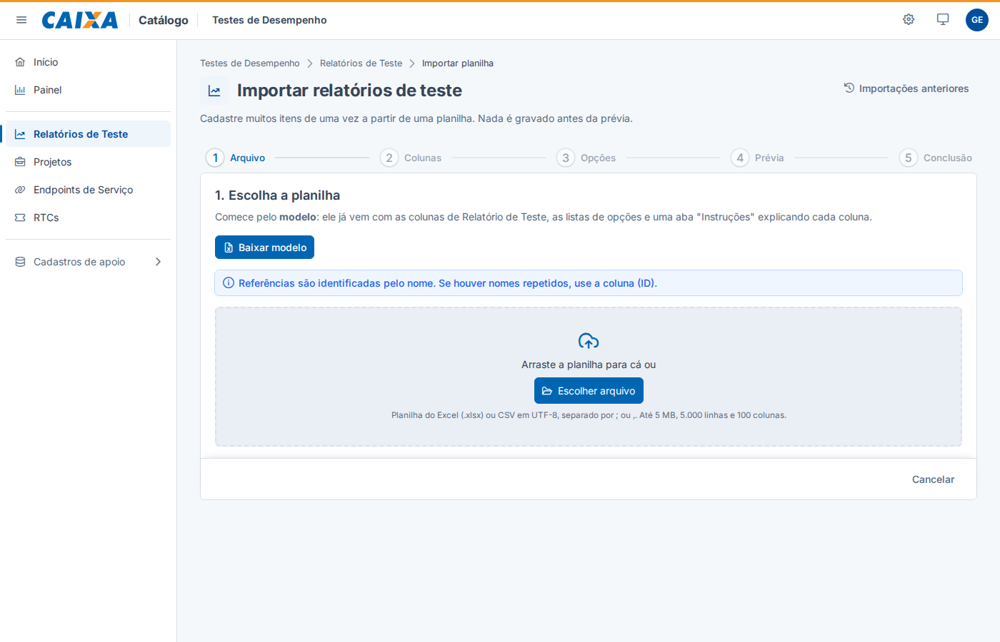
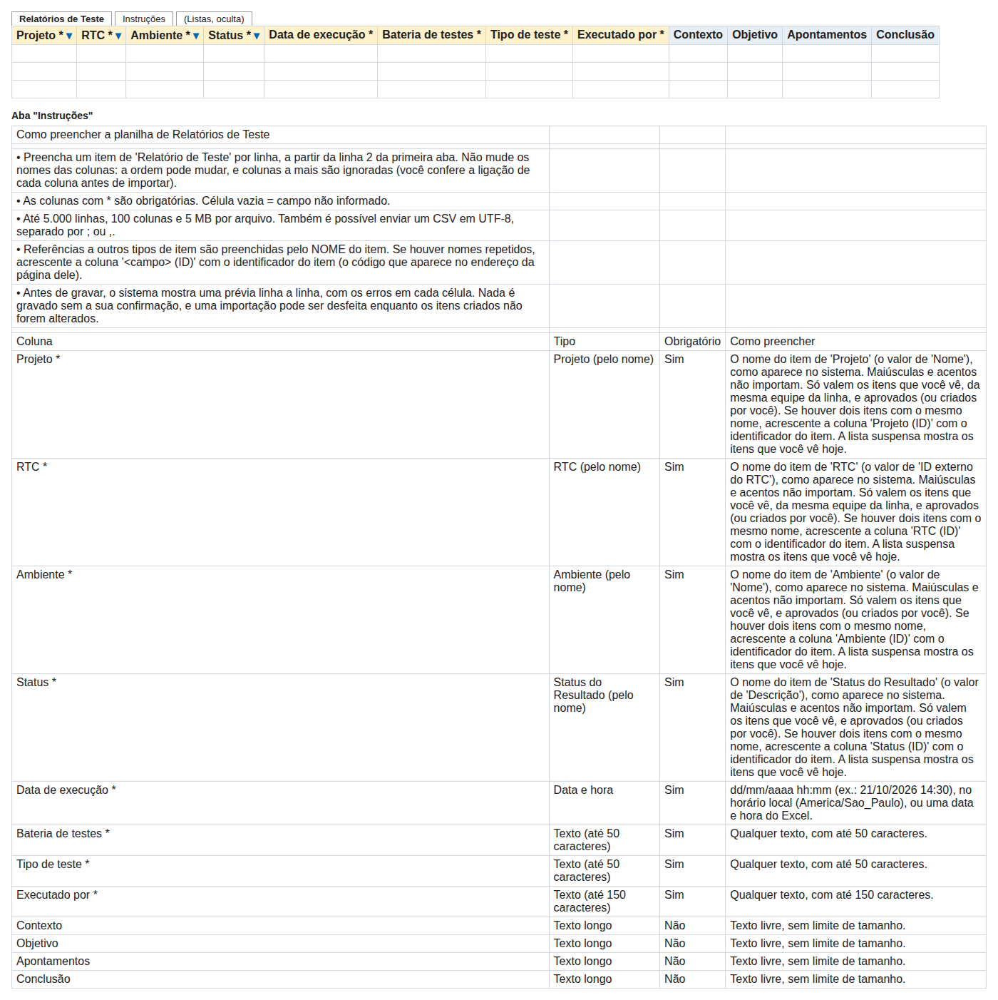
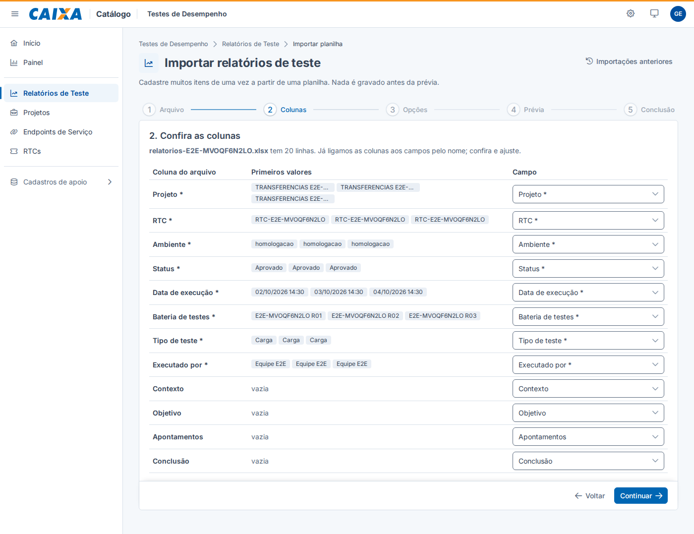
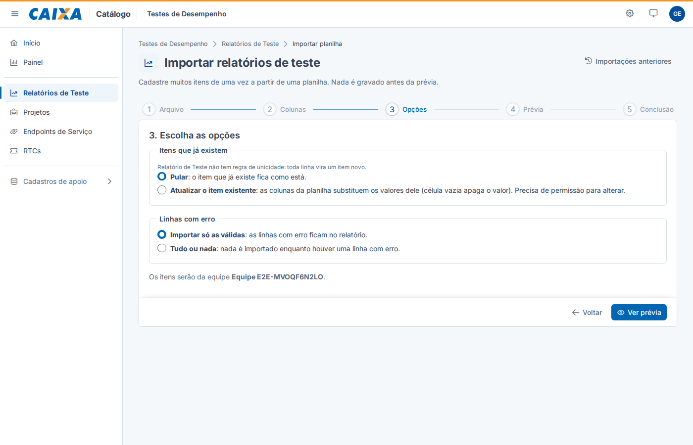
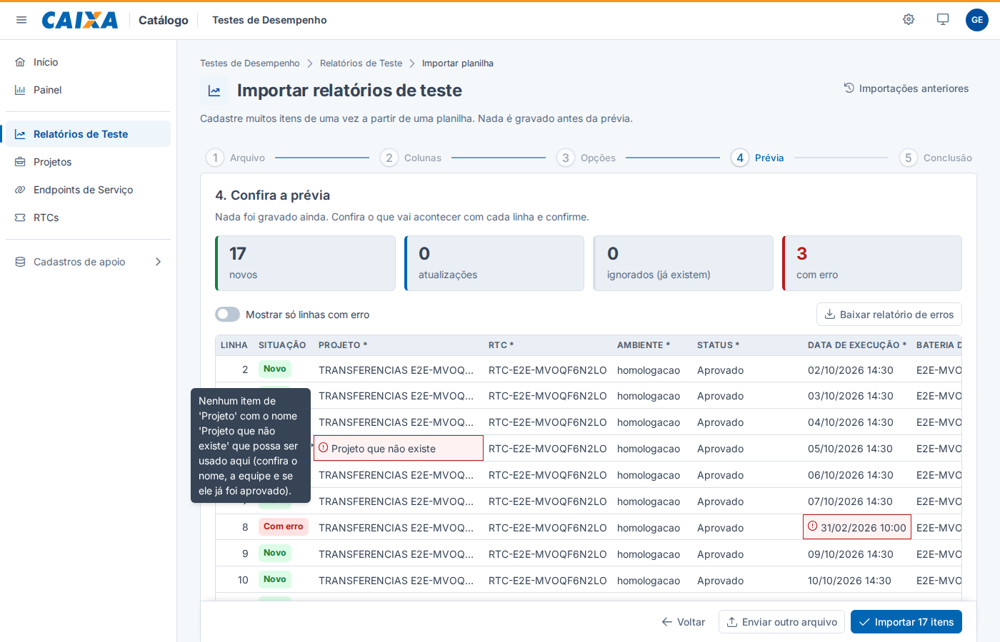
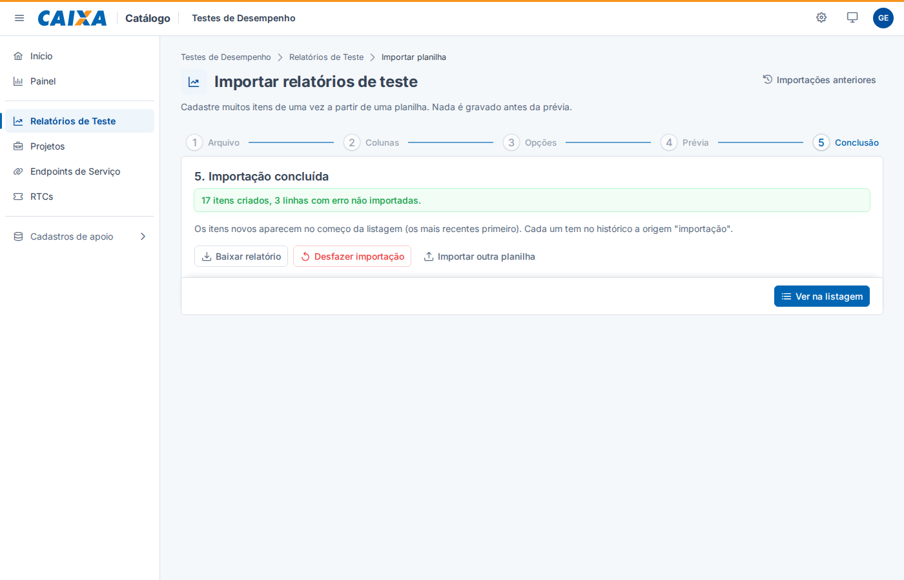
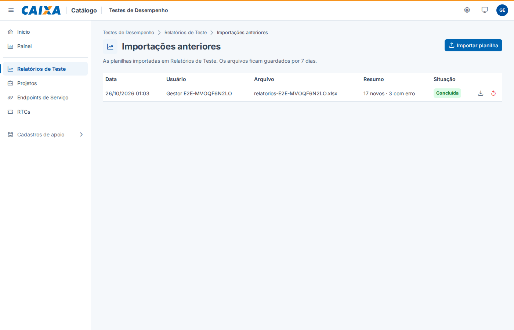
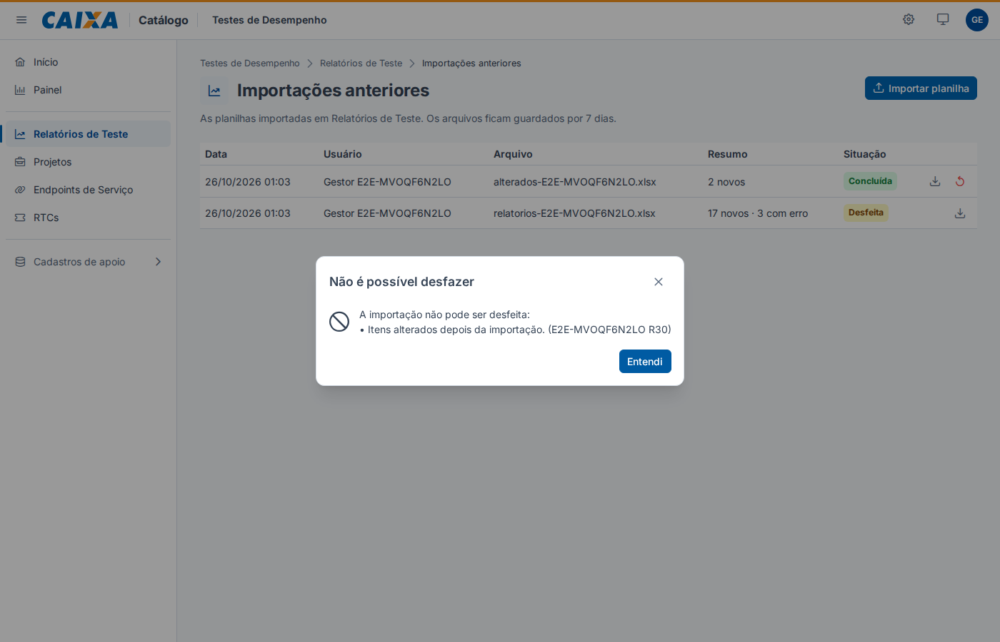

# Guia: importar itens de uma planilha

Com a **importação**, você cadastra muitos itens de uma vez a partir de uma planilha do Excel (.xlsx) ou de um arquivo CSV, em
qualquer tipo de item. Os itens importados passam pelas **mesmas regras** do cadastro pela tela: campos obrigatórios, opções,
referências, unicidade, equipes e aprovação. **Nada é gravado antes de você ver a prévia e confirmar**, e uma importação pode ser
desfeita.

> Quem pode importar é quem pode **criar** itens naquele tipo de item. Nos cadastros de apoio (Ambiente, Status...), só o
> administrador. As imagens deste guia vêm de uma equipe de teste ("E2E-…"); na sua tela aparecem os seus nomes.
> Regras completas: RN97 a RN104 em `docs/regras-de-negocio.md`, no repositório do back-end.

## Um tipo de item por vez

Cada importação cadastra **um** tipo de item. Quando um item depende de outro (o cenário de teste pertence a um relatório),
importe em duas etapas: **primeiro os relatórios, depois os cenários**, que apontam para o relatório pelo nome.

## 1. Baixar o modelo

Na listagem do tipo de item, clique em **Importar** (ao lado de **Exportar**). Na primeira etapa, clique em **Baixar modelo**.

O modelo já vem pronto para o tipo de item:

- uma coluna para cada campo, **na ordem do formulário**; as obrigatórias têm `*` no nome (e fundo amarelo);
- **listas suspensas** nas opções (Sim/Não, listas) e nas referências com poucos itens (Projeto, RTC, Ambiente...);
- datas e números já formatados;
- a aba **Instruções**, que explica cada coluna: o tipo, se é obrigatória, o tamanho, as opções, como a referência é encontrada,
  as dependências e as regras de unicidade.

## 2. Preencher

- **Um item por linha**, a partir da linha 2. Não mude o nome das colunas (a ordem pode mudar; colunas a mais são ignoradas).
- **Célula vazia** = campo não informado.
- **Números**: vírgula ou ponto decimal (`1.234,56` ou `1234.56`). **Datas**: `dd/mm/aaaa` (e `hh:mm` na data e hora), ou a data
  do próprio Excel. **Sim/Não**: também vale Verdadeiro/Falso ou 1/0. **Listas**: maiúsculas e acentos não importam.
- Limites: **5.000 linhas**, 100 colunas e **5 MB** por arquivo. Também dá para enviar um **CSV** em UTF-8, separado por `;` ou `,`
  (no Excel: "Salvar como" → "CSV UTF-8").

### Referências pelo nome

Numa coluna que aponta para outro tipo de item (Projeto, Relatório...), escreva o **nome** do item, como ele aparece no sistema:
"Transferências Alfa", "transferencias alfa" e "TRANSFERÊNCIAS ALFA" valem igual. O sistema procura **só entre os itens que você
vê**: da mesma equipe da linha (ou cadastros de apoio) e aprovados (ou criados por você).

- Se o nome **não existe**, a linha fica com erro, na célula da referência.
- Se há **dois itens com o mesmo nome**, a linha também fica com erro: acrescente uma coluna **"&lt;campo&gt; (ID)"** (por exemplo,
  `Projeto (ID)`) com o identificador do item, que aparece no endereço da página dele. O ID vale mais que o nome.
- Quando há uma regra de dependência (o endpoint precisa ser do projeto do relatório), entre itens de mesmo nome vale o que atende
  à regra.

## 3. Enviar e conferir as colunas

Arraste a planilha para a área tracejada ou clique em **Escolher arquivo**. Na etapa **Colunas**, o sistema já ligou cada coluna ao
campo de mesmo nome e mostra os três primeiros valores de cada uma. Mude o que precisar, ou escolha **Ignorar esta coluna**. Se um
campo obrigatório ficar sem coluna, aparece um aviso.

## 4. Escolher as opções

- **Itens que já existem**: um item "já existe" quando tem o mesmo valor numa regra de unicidade (por exemplo, o mesmo Relatório e
  Nº do cenário). **Pular** deixa o item como está; **Atualizar o item existente** troca os valores dele pelos da planilha (célula
  vazia apaga o valor) e exige permissão para alterar. Duas linhas iguais **na própria planilha** são sempre erro, nas duas.
- **Linhas com erro**: **Importar só as válidas** (as com erro ficam no relatório) ou **Tudo ou nada** (nada é importado enquanto
  houver erro).
- **Equipe**: quem tem uma equipe só não escolhe nada. Com mais de uma, escolha a equipe dos itens ou preencha a coluna **Equipe**
  (com o nome da equipe) na planilha.

## 5. Conferir a prévia e corrigir os erros

Clique em **Ver prévia**. O sistema testa cada linha com todas as regras, **sem gravar nada**, e mostra quantos itens serão
criados, atualizados, ignorados e quantas linhas têm erro. Cada **célula com erro** fica destacada, com um ícone; passe o mouse (ou
navegue com o teclado) para ler a mensagem. Erros que não são de uma célula (linha repetida, campo obrigatório sem coluna)
aparecem em **Observações**.

- **Mostrar só linhas com erro** filtra a tabela.
- **Baixar relatório de erros** gera uma planilha com as suas linhas e duas colunas a mais, **Resultado** e **Mensagens**.
- **Para corrigir**, ajuste a planilha e clique em **Enviar outro arquivo**: as colunas que você ligou continuam ligadas.

Quando estiver tudo certo, clique em **Importar N itens**. Se algo mudou desde a prévia (por exemplo, alguém excluiu um projeto
citado na planilha), **nada é gravado**: a prévia é refeita, você confere e confirma de novo.

## 6. Conclusão

Os itens novos aparecem no começo da listagem. No histórico de cada item, a gravação aparece com a origem **Importação**.

## Importações anteriores e desfazer

Na listagem, a seta ao lado de **Importar** abre **Importações anteriores**: data, quem importou, o arquivo, o resumo e a situação,
com o relatório de cada uma. Cada pessoa vê as suas; o gestor, também as da equipe; o administrador, todas. Os arquivos ficam
guardados por **7 dias**; depois disso, o relatório não está mais disponível.

**Desfazer** exclui os itens que a importação **criou** (as atualizações não voltam atrás). Quem desfaz precisa poder excluir
itens (gestor ou administrador), e só dá para desfazer se nenhum item criado foi alterado depois (nem aprovado ou avaliado) e se
nenhum outro item aponta para eles. Por isso, se você importou relatórios e depois os cenários deles, desfaça **primeiro os
cenários**. Quando não é possível, o sistema diz por quê e quais itens impedem:

